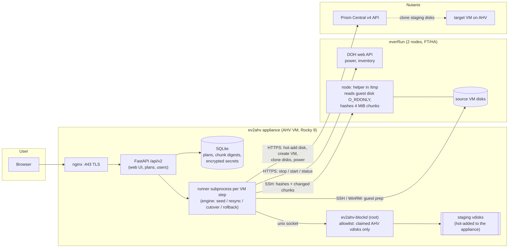

# How ev2ahv works

ev2ahv copies a running everRun VM's disks to AHV in fixed-size chunks and keeps the copy up to date. At cutover
it stops the source once, copies the last changes, verifies them, and boots the AHV copy. Rollback means
powering the everRun VM back on. The source disks are never written to.

## Components



There are two run modes. The diagram shows the appliance. In bastion and CLI mode a separate `ev2ahv-writer` VM
holds the staging disks and `bin/ev2ahv` drives it over SSH; the logic is the same.

## Lifecycle of one VM

```mermaid
sequenceDiagram
  autonumber
  participant E as ev2ahv engine
  participant S as everRun source (running)
  participant P as Prism
  participant W as staging vdisks
  Note over E,S: Preparing
  E->>S: guest prep (drivers, keep IP/MAC), then 18 pre-checks
  Note over E,W: Seeding (VM keeps running)
  E->>P: hot-add one staging vdisk per source disk
  E->>S: read every chunk, hash it
  S-->>W: send chunks that are not zero
  Note over E,W: Ready to cutover (every N minutes)
  E->>S: resync: hash again, send only the chunks that changed
  Note over E,P: Cutover (the only downtime)
  E->>S: stop the guest (DOH API)
  E->>S: final sync with the source off, repeated until a pass sends nothing
  E->>W: hash the target too (verifies and repairs it)
  E->>P: create the target VM (same MAC), clone the staging disks into it, power on
  E->>P: verify: powered on, reachable on its IP
  Note over E,S: Rollback (if needed)
  E->>P: power off the AHV VM
  E->>S: start the everRun source; staging disks are kept for a quick retry
```

## Key ideas

| Idea | Why |
|---|---|
| Chunk digests in SQLite | A resync sends only what changed. A step can resume after a crash or reboot, and data is committed only after fsync |
| Staging disks, then clone | AHV can't attach a disk to another VM. Cloning the staging vdisks into the new VM is instant, and removing a vdisk deletes it, so they stay until cleanup |
| Final sync with the source off | The only point where the copy is crash-consistent. That makes downtime = stop + final sync + boot |
| Root helper allowlist | The app runs unprivileged. blockd writes only to AHV vdisks ev2ahv hot-added itself, never to a disk in use at boot |
| `ev2ahv-*` name guard | In the lab the tool only touches its own VMs (Source VM name prefix setting) |
| Changed-block tracking (D5, prototype) | Today every resync reads the whole disk. QEMU dirty bitmaps would make resyncs 10-25x faster |

Code map:
- engine: `ev2ahv/workflow.py`, `engine.py`, `readers.py`, `target.py`, `prism.py`, `everrun_api.py`, `blockd.py`
- server: `server/ev2ahv_server/` (`api.py`, `live.py`, `runner.py`)
- UI: `web/`
- appliance image: `appliance/`
