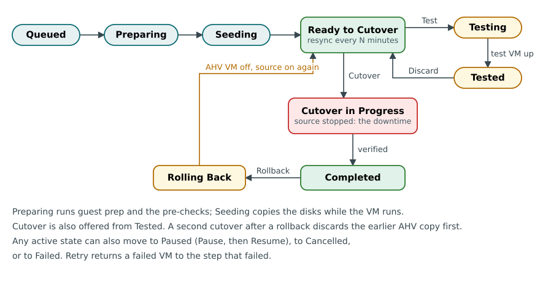
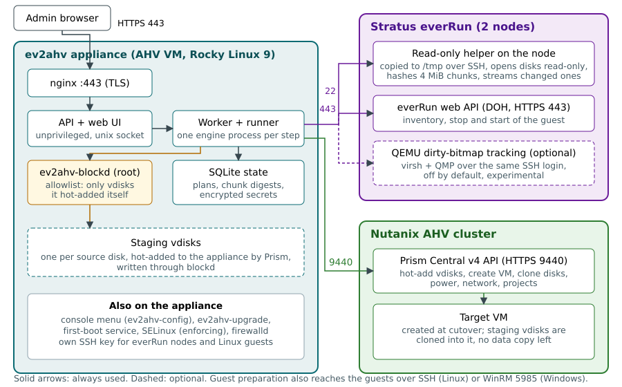
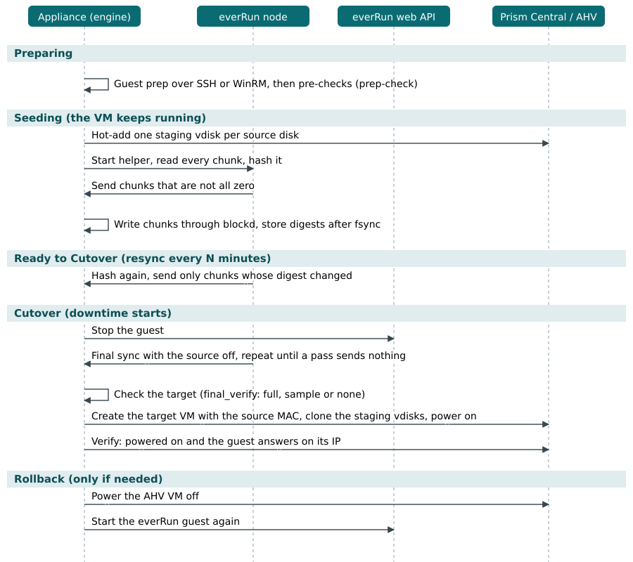
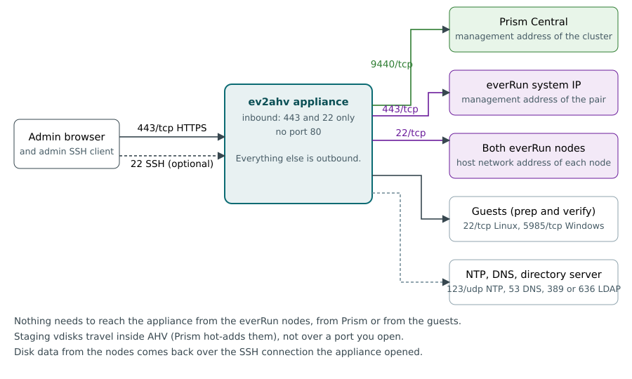
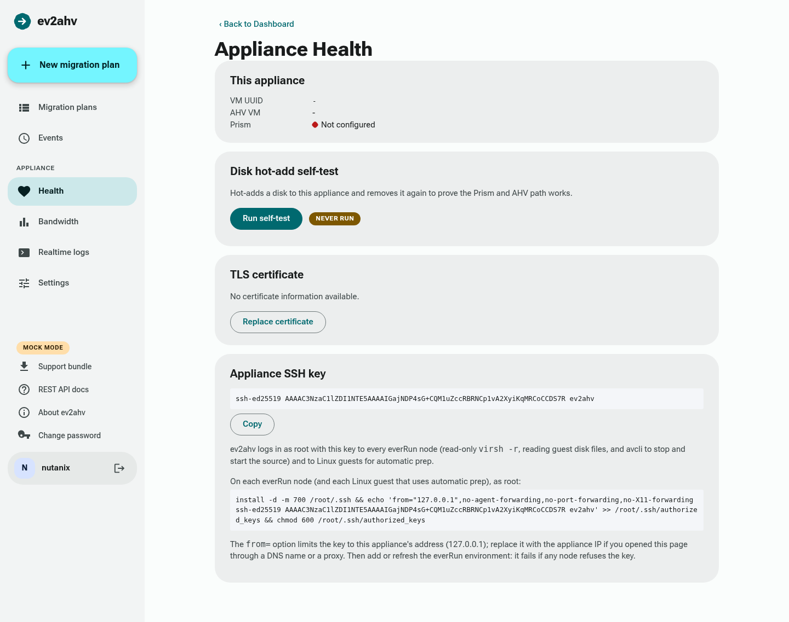
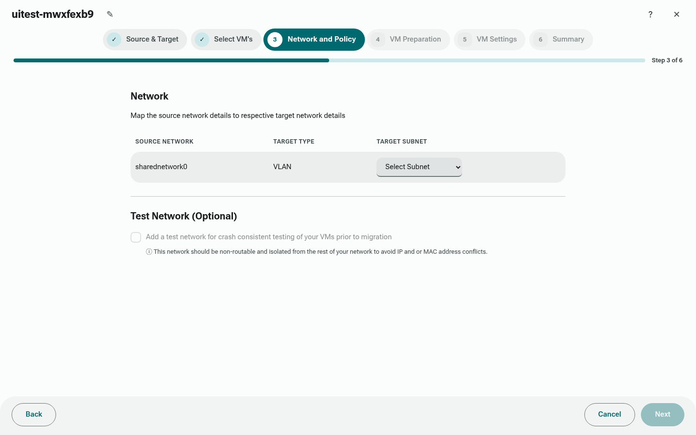
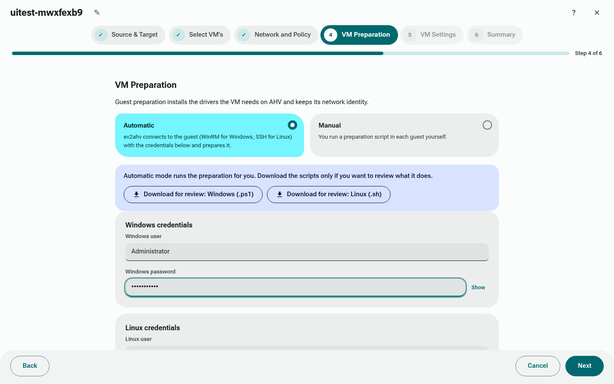

# ev2ahv: Migrating Stratus everRun VMs to Nutanix AHV

**Product Guide.** Version 0.3.9, 28 November 2026.

# About this guide

This guide is for the people who plan and run a move of virtual machines from Stratus everRun to Nutanix AHV: virtualization and infrastructure administrators. It explains what ev2ahv does, how to deploy and operate it, what it costs your source systems, and where it stops.

**Reading order.** Read chapters 1 to 3 before you buy time on anyone's calendar. Deploy and configure with chapters 4 and 5. Chapters 6 to 8 are the migration itself. Chapter 9 is where you size the window. Keep chapter 12 open during the work.

**What the labels mean.** The guide says what we saw, and where. "Tested" means we ran it on a real system in our lab and checked the result. "From the design" means the behaviour follows from the code and has not been measured. "Not tested" means exactly that. Chapter 13 collects the limits in one place.

<div class="callout warn" markdown="1"><b>Test status</b><br>
ev2ahv was tested end to end against everRun 8.1.1 with a Rocky Linux 9 FT guest and a Windows Server 2022 HA guest, both BIOS. Other guest operating systems, UEFI guests and larger production workloads have not been run through a full cutover. Chapter 13 lists the gaps. Plan a test migration of a representative VM before you commit a window.</div>

**Conventions.** Addresses such as 192.0.2.50 are documentation placeholders; use your own. Times in the console follow the timezone you set in Settings; logs and the engine's timestamps are UTC. Commands you type are in code blocks. Boxes marked Warning are about data, downtime or security.

# 1. What ev2ahv is

ev2ahv moves virtual machines from Stratus everRun to Nutanix AHV. It copies the disks while the VM keeps running, keeps the copy current, and cuts over in a short window in which the source is stopped, the last changes are copied and checked, and the AHV VM is started. If the AHV VM does not look right, you power the everRun VM back on.

If you have used Nutanix Move, the workflow will feel familiar: environments, migration plans, a six-step wizard, seeding, scheduled resyncs, test, cutover. The engine underneath is different, because it reads everRun disks directly and knows how everRun powers VMs on and off.

## 1.1 The problem

everRun runs each VM as a QEMU/KVM guest on two clustered nodes, either as a fault-tolerant (FT) pair or in high-availability (HA) mode. The guest's disks are plain raw files on the node's storage. Nothing in everRun exports them in a form AHV can import, and a guest that has Stratus drivers, a static IP and a NIC named after everRun's virtual hardware does not simply boot on another hypervisor.

So a migration has four parts:

1. Copy the disks without a long outage.
2. Make the guest able to boot on AHV: drivers, network identity, disk names.
3. Switch over with a short, predictable outage and a way back.
4. Check that the VM on AHV is the VM you had.

ev2ahv does all four from one web console.

## 1.2 How it works in one page

**Seed.** The appliance starts a small read-only helper on the everRun node that owns the VM. The helper reads the guest's disk files in 4 MiB chunks and sends a hash of every chunk. For each chunk that is not all zeros, the appliance asks for the data and writes it to a staging disk. Staging disks are ordinary AHV vdisks that Prism hot-adds to the appliance VM. The guest keeps running and writing during this pass.

**Resync.** The appliance stores the hash of every chunk it has written. At the resync interval (every 60 minutes unless you change it) it hashes the source again and sends only the chunks whose hash differs. A resync of a quiet VM is short; its cost is the time to read the allocated data on the node.

**Cutover.** When you start a cutover, ev2ahv stops the guest through the everRun web API. With the guest off, nothing can change on the source, so a final sync produces a copy that is exactly consistent. Then it creates the AHV VM, clones the staging vdisks into it, powers it on and checks that it is running and answers on its address. The time from the stop request to a verified VM is the downtime.

**Rollback.** Rollback powers the AHV VM off and starts the everRun VM again. Data written on AHV after cutover is not copied back.

<div class="callout tip" markdown="1"><b>What ev2ahv never does to the source</b><br>
It reads disks, stops the VM and starts the VM. It does not write to the source disks, take snapshots, use VSS, change the everRun configuration or remove the VM. The source helper opens disk files read-only and refuses mounted or held devices. The only changes inside a guest are made by the preparation scripts, and those are reversible: after a rollback the guest boots normally on everRun.</div>



## 1.3 When to use ev2ahv, and when not to

ev2ahv fits when the source is everRun 8.x, the guests are Linux or Windows Server, and you want to keep IP addresses and MAC addresses and accept a downtime measured in minutes. In our lab, a 40 GiB FT Rocky Linux guest had a downtime of between 2.7 and 7 minutes depending on the final check you choose (chapter 9).

| Situation | Better choice |
|---|---|
| The VM can be rebuilt from automation or an installer | Redeploy it on AHV. No migration tool is faster than not migrating |
| Application-level replication already exists (database replica, cluster member, AD domain controller) | Add an AHV node to the application cluster and fail over. This gives you the shortest outage and an application-consistent move |
| You need zero downtime | ev2ahv cannot give it. The source is stopped during the final sync |
| The source is something other than everRun (VMware, Hyper-V, bare metal) | Nutanix Move |
| The guest uses a guest OS or firmware we have not tested (chapter 13) | Test it first with the test migration, or use a different method |
| An in-guest or hypervisor backup you can restore onto AHV already exists and a restore window is acceptable | Restore from backup. It does not touch the source at all |


# 2. Architecture

This chapter describes every component, how data moves, and what happens when something fails. You do not need it to run a migration; you need it when you decide where to put the appliance, what to open on the firewall, or what to tell your security team.

## 2.1 Components



### The appliance

The appliance is a Rocky Linux 9 VM that runs on the AHV cluster you are migrating to. It holds all state and does all the work.

| Component | What it does |
|---|---|
| nginx | Terminates TLS 1.2 and 1.3 on port 443, serves the web console and proxies `/api/` to the application over a unix socket. There is no port 80 |
| API and web UI | A FastAPI service that runs as an unprivileged user with no capabilities. It serves the console, stores plans and environments, enforces user roles and starts engine steps |
| Worker and runner | A scheduler loop inside the service decides what each VM needs next (prepare, seed, resync, cutover, rollback). It starts one engine process per step, so a crash of a step cannot take the web service with it |
| ev2ahv-blockd | A small helper that runs as root, started by systemd for each connection on a unix socket that only the application's group can open. It is the only process that writes raw disk blocks. It has an allowlist, described in 2.6 |
| SQLite state | Plans, environments, per-VM state, per-chunk digests and events, in `/var/lib/ev2ahv`. Secrets are in the same database, encrypted with a key that is created on first boot |
| Staging vdisks | One AHV vdisk per source disk. Prism hot-adds them to the appliance VM during seeding. They are cloned into the target VM at cutover and stay until you clean up |
| Console menu | A text menu on the VM console for network, hostname, NTP and recovery tasks (Appendix C) |
| ev2ahv-upgrade | The upgrade and rollback tool for the appliance software (chapter 11) |

### The everRun side

| Component | What it does |
|---|---|
| SSH access as root | The appliance logs in to both everRun nodes with its own SSH key. It runs read-only libvirt queries (`virsh -r`) for discovery and starts the disk helper |
| Disk helper | A small Python program copied to `/tmp` on the node. It opens the guest's raw disk file read-only, hashes 4 MiB chunks, skips holes in sparse files, and streams only the chunks the appliance asks for. It uses only the Python standard library |
| everRun web API (DOH) | The appliance reads the inventory, including the FT or HA level, and stops and starts guests through the same HTTPS interface the everRun portal uses. It logs in with the everRun administrator account you enter in the environment |
| QEMU dirty-bitmap tracking | Optional and off by default. With it, the node's QEMU remembers which parts of a disk were written, so a resync reads only those. It is experimental (section 2.5) |

### The Nutanix side

| Component | What it does |
|---|---|
| Prism Central v4 API | The appliance asks Prism Central to hot-add and remove staging vdisks, create the target VM, clone disks, set the boot disk, attach NICs and change power state. It also reads clusters, storage containers, subnets and projects. A few calls use the v3 API (tasks, projects, image upload) |
| Target VM | Created at cutover with the source's CPU, memory, MAC addresses and firmware. The staging vdisks are cloned into it, so there is no further copy |

The appliance must run on the cluster that will host the migrated VMs. Prism hot-adds the staging disks to the appliance VM, and AHV cannot attach one VM's vdisk to a VM on another cluster.

## 2.2 Data flow for one VM



The flow has these properties:

- **Digests are committed after the write is safe.** A chunk's hash goes into the database only after the staging disk has flushed that chunk. If the appliance stops at any point, the database never claims more than the disk holds, and the step resumes from its last committed position.
- **The recorded hash is the hash of the bytes actually read.** If the guest changes a chunk while it is being copied, the next pass sees a different hash and sends the chunk again.
- **Zero chunks are not sent** to a fresh disk, and are written over existing data only when the target is not already zero. This keeps the seed of a thin-provisioned VM short.

## 2.3 The per-VM lifecycle

The lifecycle diagram in chapter 1 shows the states. The table says what each one means and what you can do in it.

| State | What is happening | Actions offered |
|---|---|---|
| Queued | The plan has not started, or the VM waits for its turn | Cancel |
| Preparing | Guest preparation (automatic mode) and the pre-checks | Pause, Cancel |
| Seeding | The first full copy. The VM keeps running | Pause, Cancel |
| Ready to Cutover | The VM is seeded and is resynced at the plan's interval | Cutover, Resync now, Test, Pause, Cancel |
| Testing | A test VM is being created on the test subnet | none |
| Tested | The test VM exists and the source still runs | Cutover, Resync now, Test, Discard, Cancel |
| Cutover in Progress | The source is stopped, the final sync runs, the AHV VM is created and started | none |
| Completed | The AHV VM is up and verified | Rollback |
| Rolling Back | The AHV VM is being powered off and the source started | none |
| Paused | You paused the VM; Resume returns it to where it was | Resume, Cancel |
| Failed | A step stopped with an error shown in the VM's row | Retry, Cancel |
| Cancelled | You cancelled it | none |

The console also lists a state called Scheduled for Cutover. This version never sets it, because cutover is started by hand.

After a rollback the VM returns to Ready to Cutover and resyncs again. The next cutover first discards the previous AHV copy, because it holds the guest's MAC address and old data.

## 2.4 Chunks, digests and the final sync

**Chunks.** Every disk is divided into 4 MiB chunks. The appliance keeps one digest per chunk in SQLite. The hash algorithm is negotiated between the two ends: xxh64 if both sides have it, otherwise blake2b. The everRun nodes in our lab did not have xxhash, so blake2b was used.

**Pass types.**

| Pass | Source read | Target read | Used for |
|---|---|---|---|
| Seed | Whole disk (holes skipped) | None | The first copy |
| Resync | Whole disk, or only changed chunks with change tracking | None | Keeping the copy current |
| Final source pass | Whole disk, with the guest off | None | Sending everything that differs from the recorded digests |
| Final verification | Whole disk again | Target disk | Proving that the target matches, repairing it if not |

**The final sync.** The source pass always runs and always sends every chunk whose digest differs from the recorded one. What happens next is the per-VM setting **Final sync check** (`final_verify`):

| Setting | After the source pass | Cost | Trade-off |
|---|---|---|---|
| `full` (default) | Hash the target too and compare every chunk. Repeat until a pass sends nothing | Slowest. Roughly a second full read of source and target | Detects and repairs any difference, including damage to the staging disk. Use it for production VMs |
| `sample` | Compare a random 1 percent of each disk (at least 64 chunks) between source and target. Any difference triggers the full verification | Medium | A cheap spot check. It can miss a rare corrupt chunk |
| `none` | Trust the recorded digests | Fastest | A digest is recorded only after the target flushed the chunk, so the target is exact for every chunk the source pass saw. It cannot see damage done to the staging disk behind ev2ahv's back |

<div class="callout tip" markdown="1"><b>Change tracking is not used for the final sync</b><br>
We tried it with everRun's own change tracking and removed it. everRun's QEMU exits with the guest, so after a normal stop there is nothing left to ask. Pausing the guest through QEMU did not hold, because everRun resumed it within a second. And disk silence is not proof that the guest has finished: in one run the guest wrote to its boot disk 1.5 to 4.6 seconds after a 4.6 second quiet period, and the change list missed two chunks. A final sync that reads the stopped source is slower but exact.</div>

## 2.5 Changed-block tracking (cbt)

Without tracking, every resync hashes every allocated chunk of every disk on the node. That reads a lot of data even when little changed. With `cbt: auto`, the appliance asks the guest's QEMU to record which 64 KiB regions were written (a QEMU dirty bitmap), rotates the bitmap at each resync, and reads only the chunks that touched changed regions.

- It is a **per-VM setting, off by default**, in the wizard as "Changed-block tracking".
- It only accelerates resyncs. The final sync does not use it.
- It adds a bitmap to the running guest's QEMU, in memory only. Nothing is written to the guest's disks. After the migration the bitmaps are removed.
- The bitmap is lost when QEMU restarts or an FT guest fails over. ev2ahv notices, does one full pass, starts tracking again, and the resync after that is a dirty-only pass again. We tested this with a real FT failover.
- It works by sending QEMU monitor commands to the guest. Stratus's public documentation says everRun users should make no changes to the QEMU virtualization engine, and we have not asked Stratus whether this use is acceptable. Treat it as experimental and as outside what Stratus documents; get Stratus's agreement before you enable it on a production guest. Chapter 9 has measured gains.

## 2.6 Failure handling and resume

| Event | What ev2ahv does |
|---|---|
| The appliance reboots or the service restarts during a step | The step is marked interrupted and resumes from the last committed chunk when the service is back. In our test, a reboot at 31.2 percent of a seed resumed from 31.2 percent, not from zero |
| A step fails (network error, Prism task error, a guest check) | The VM goes to Failed with the error text. Retry restarts at the step that failed. Finished steps in a cutover are skipped |
| A resync after a rollback cannot find the source in discovery | It reuses the plan it stored during the seed and retries every 60 seconds, up to 20 times, while the VM stays in Ready to Cutover |
| The final sync keeps finding differences | Cutover stops with an error after five verified passes. The usual cause is that the source guest is still running; check that it is off |
| The AHV VM does not answer after power-on | The verification step times out and fails the cutover. The source is still stopped; Rollback powers it on again |
| A cutover is asked for while a prep-check shows FAIL | The console refuses unless you choose "Cutover anyway" |

## 2.7 Security model in brief

Chapter 10 has the details. The short version:

- The web service runs unprivileged. Raw disk writes go through `ev2ahv-blockd`, which accepts only whole `/dev/sdX` devices that carry an AHV vdisk serial, that were not in use at boot, and that ev2ahv itself hot-added and claimed. It refuses the appliance's own system disk, optical drives and everything that is not a block device.
- The everRun helper is read-only, and the appliance's SSH key can be limited to the appliance's own address (the Health page generates the restricted line).
- Credentials you enter are write-only: the API never returns them, and they are stored encrypted.

## 2.8 Network ports and flows

The appliance opens every connection except the ones from your browser. The full table is in chapter 3.



# 3. Requirements

## 3.1 Supported versions

| Component | What we tested | Notes |
|---|---|---|
| Stratus everRun | 8.1.1 (build 285) | HA and FT guests. Other 8.x versions use the same libvirt/QEMU layout but have not been run |
| Guest operating systems | Rocky Linux 9 (FT), Windows Server 2022 (HA), both BIOS | Other Linux distributions and Windows versions are not tested. See chapter 13 |
| Nutanix | Prism Central with the v4.2 VMM and cluster-management APIs and the v4.0 networking and prism APIs, plus a few v3 calls | We did not record a tested AOS and Prism Central matrix for this guide. Confirm with your Nutanix contact that the v4 APIs are enabled on your Prism Central |
| Appliance hypervisor | AHV, BIOS and UEFI boot | The UEFI boot of the image was tested; migrated UEFI guests were not |
| Browser | A current Chrome | The console was tested in Chrome |

## 3.2 Appliance sizing

| Resource | Minimum | Recommended | Notes |
|---|---|---|---|
| vCPU | 2 | 2 | Each running step adds one engine process of about 60 to 100 MiB |
| Memory | 2 GiB | 4 GiB | About 460 to 475 MiB used while idle in our tests |
| Disk | 20 GiB | 20 GiB | The root partition grows to the disk size on first boot if you make the disk larger. The appliance stores state only; staging vdisks are separate |
| NIC | 1 | 1 | It needs to reach Prism Central, the everRun system and nodes, and the guests |

**Storage for the migration itself.** The staging vdisks are created in the storage container you pick in the plan, one per source disk at the source disk's full virtual size. Zero chunks are not written, but plan capacity as if every disk will end up at its full size, because the target VM keeps these disks. A 70 GiB VM needs 70 GiB of capacity in the container (plus the replication factor of that container).

## 3.3 Network ports

All connections are made by the appliance. Open them from the appliance's address.

| From | To | Port | Used for |
|---|---|---|---|
| Admin browser | Appliance | 443/tcp | Web console and REST API |
| Admin SSH client | Appliance | 22/tcp | Optional shell access as `admin` |
| Appliance | Prism Central | 9440/tcp | v4 and v3 API |
| Appliance | everRun system (management) IP | 443/tcp | Inventory, stop and start of guests |
| Appliance | Each everRun node | 22/tcp | Discovery, disk helper, optional change tracking |
| Appliance | Linux guests | 22/tcp | Automatic prep and the check after cutover |
| Appliance | Windows guests | 5985/tcp | WinRM over HTTP with NTLM, for automatic prep and the check after cutover |
| Appliance | NTP servers, DNS servers | 123/udp, 53 | Time and name resolution |
| Appliance | Directory server | 389 or 636/tcp | Only if you enable LDAP sign-in |

The appliance's host firewall allows only SSH and HTTPS inbound. Nothing needs to connect to the appliance from the everRun nodes, from Prism or from the guests.

<div class="callout warn" markdown="1"><b>WinRM is plain HTTP</b><br>
Automatic preparation of Windows guests uses WinRM on port 5985 with NTLM authentication. The credentials are not sent in clear text, but the session is not TLS-encrypted. If that is not acceptable on your network, use manual preparation for Windows guests.</div>

## 3.4 Accounts and permissions

| Account | Where | Needed for |
|---|---|---|
| Prism Central API key, or a user name and password | Prism Central | Everything on the Nutanix side. Prefer an API key; a password account can also sign in to the Prism UI |
| everRun administrator | everRun portal | Inventory, and stopping and starting guests |
| Root SSH on both everRun nodes | The appliance's own key | Reading guest disk files, `virsh -r`, change tracking |
| Guest administrator (Windows) or root (Linux) | Each guest | Automatic preparation only. Not needed for manual preparation |
| Local console accounts | The appliance | The `nutanix` web account and the `admin` shell account, both with a forced password change |

<div class="callout warn" markdown="1"><b>Permissions we did not narrow</b><br>
We tested with administrator-level Prism and everRun accounts. We have not tried a reduced Prism role, so we cannot tell you the smallest set of permissions that works. If your policy requires least privilege, build the role by testing a throw-away plan against a test VM, and expect to add what the errors name. The root SSH requirement on the everRun nodes is inherent: the guests' disk files are only readable by root. Stratus documents root SSH to the nodes for its own procedures, but recommends a non-root account for third-party tools and warns that such tools can destabilize a node. Running ev2ahv's helper as root may fall outside your Stratus support terms; ask Stratus before you start.</div>

## 3.5 Before you start

- The everRun guest must be **running**. A stopped everRun guest is listed, but its disks are unknown until it runs, so it cannot be seeded.
- The guest must run on exactly one node. For FT guests, the second node holds the paused partner.
- Give the target a free IP and, if you keep the source's address, accept that the source and the AHV copy must never run at the same time (section 8.5).
- Decide the target storage container and the destination subnet for each source network, and collect the virtio-win ISO if you migrate Windows guests (7.3).

# 4. Deploying the appliance

## 4.1 Get and check the image

You receive `ev2ahv-<version>.qcow2` with a `.sha256` file. Check it before you upload it:

```
sha256sum -c ev2ahv-0.3.9.qcow2.sha256
```

The image is about 300 MB. Always deploy from the pristine image. Do not clone a running appliance to make a second one: the SSH host keys, the TLS certificate and the secret-encryption key are created once, at first boot, and a clone would share them.

## 4.2 Upload the image and create the VM

1. In Prism, upload `ev2ahv-<version>.qcow2` as a **disk** image (Settings, Image Configuration).
2. Create a VM with these settings:

    - 2 vCPU and 4 GiB of memory (the minimum is 2 vCPU and 2 GiB).
    - One disk cloned from the image. 20 GiB is enough; a larger disk is grown automatically on first boot.
    - **SCSI** disk bus. The image boots with legacy BIOS or with UEFI.
    - One NIC on a subnet that can reach Prism Central, the everRun system and nodes, and the guests (section 3.3).

3. Put the VM on the AHV cluster that will host the migrated VMs.
4. Power it on.

If you give the VM a static address through your own tooling, check first that nothing else uses it. A DHCP pool that overlaps devices you did not know about produces an appliance that answers from the wrong machine.

## 4.3 First boot and the console menu

The first boot takes about 20 seconds. Open the VM's console in Prism. It shows the `ev2ahv-config` menu and, once the VM has an address, the web address.

```
=== ev2ahv appliance 0.3.9 ===
Web UI: https://192.0.2.50/

  1) Show status / URL
  2) Network: DHCP or static IPv4
  3) Hostname
  4) NTP servers
  5) Toggle SSH password authentication
  6) Reset web UI admin password to default
  7) Show TLS certificate fingerprint
  8) Regenerate self-signed TLS certificate
  9) Login shell
```

Do these in order:

1. **Network (2).** Choose `d` for DHCP, or `s` and enter the address with its prefix (for example `192.0.2.50/24`), the gateway and the DNS servers. The menu replaces any other Ethernet profile with one profile it manages, applies it, and prints the new URL.
2. **Hostname (3).** Set a name your DNS resolves, if you use one.
3. **NTP servers (4).** Enter your servers. Time matters here: the appliance, Prism and the everRun nodes should agree, because events and logs are timestamped and TLS certificates are checked against the clock.
4. **TLS fingerprint (7).** Write down the SHA-256 fingerprint. You compare it with the browser's warning the first time you connect.

The menu regenerates the self-signed certificate by itself after a network or hostname change while the certificate is still self-signed.

<div class="callout tip" markdown="1"><b>Anyone with the VM console has this menu</b><br>
The menu runs as root on the console and can reset the web admin password. In Prism, limit who may open consoles of the appliance VM.</div>

## 4.4 First login

Open `https://<appliance address>/`. The browser warns about the self-signed certificate; compare the fingerprint with the one from menu item 7 and continue.

Sign in as `nutanix`. The image ships with a documented initial password for this account and for the `admin` shell account; your ev2ahv contact has it. Both are marked expired. The console refuses every other action until you choose a new password of at least 8 characters, which is not the default. Until then every API call except the password change returns 403.

The `admin` account (console and SSH) is in the `wheel` group and uses `sudo` with its password. Root has no password and cannot log in over SSH. The menu's item 5 turns SSH password login on or off; before you disable it, put a key in `~admin/.ssh/authorized_keys`, or you lock yourself out of SSH.

## 4.5 Set the migration scope

Open **Settings** in the left rail (Appliance Settings). Two values matter before your first plan.

| Setting | Default | What to do |
|---|---|---|
| Source VM name prefix | `ev2ahv-` | A safety guard: only source VMs whose name starts with this text can be migrated. The default blocks every VM that is not named `ev2ahv-...`. Enter the prefix your VMs share, or leave it empty to allow any VM. Each change is logged as a warning event |
| Timezone | Asia/Jakarta (WIB) | Used to display dates and as the default for schedules. Set your own |
| Default resync interval | 1 hour | How often a seeded VM is resynced while it waits for cutover. A plan can override it |

## 4.6 Certificate

The appliance generates a self-signed certificate. To use your own, open **Health**, find **TLS certificate** and choose **Replace certificate**. Paste a PEM certificate (with its chain) and the unencrypted PEM private key. The appliance checks that the key matches the certificate and that the certificate has not expired, then replaces both and reloads nginx without restarting the application. The change is an entry in Events.

## 4.7 Health page and self-test

The Health page shows whether the appliance can do its main job.



- **This appliance** shows the VM UUID and the VM's name in Prism. If Prism is not configured yet, it says so.
- **Disk hot-add self-test** hot-adds a 1 GiB disk to the appliance itself, lets the root helper read its size, takes it offline and removes it again through Prism. A pass proves the whole Prism, AHV and blockd path. Add the Prism environment first (chapter 5), then run the test. Run it again after any upgrade.
- **TLS certificate** and **Appliance SSH key**, covered in 4.6 and 4.8.
- **Upgrade**, covered in chapter 11.

If the self-test fails, do not start a migration. The failing step is named in the result.

## 4.8 Authorize the appliance's SSH key on everRun

Each appliance creates its own ed25519 key, owned by the service user, when it first needs it. Nothing else is shipped or shared. The appliance logs in as root with this key to:

- every everRun node, to run `virsh -r` (read-only discovery), read the guest's raw disk files and start the disk helper;
- Linux guests, if you use automatic preparation.

Do this once per appliance:

1. Open **Health** and find **Appliance SSH key**. The page shows a one-line command that appends the key to `/root/.ssh/authorized_keys`, restricted with `from="<appliance address>",no-agent-forwarding,no-port-forwarding,no-X11-forwarding`. Check that the address in `from=` is the appliance's real IP. The page fills in the address you opened it with; replace it if you came through a DNS name or proxy.
2. Run that line as root on **both** everRun nodes, and in each Linux guest that will use automatic preparation. The line only appends, so existing keys stay.
3. Add (or refresh) the everRun environment in the console. Validation runs `virsh -r list` on every node and fails, naming the node, if one refuses the key. The node's SSH host key is pinned on first contact.

To rotate the key, stop the service, move the key pair out of the appliance's config directory, start the service, and repeat steps 1 to 3 with the new key from Health. Then delete the old line (comment `ev2ahv-appliance`) from the nodes and guests. To revoke an appliance, delete its line there.

# 5. Adding environments

An environment is a system ev2ahv talks to. You need one source (everRun) and one target (Nutanix AOS). Add them from **Migration plans**, **Add environment**.

## 5.1 The everRun source

| Field | Value |
|---|---|
| Environment type | Stratus everRun |
| Environment name | A display name |
| everRun system IP | The management address of the pair (the address you open the everRun portal on) |
| User name and password | An everRun administrator. Used for the web API: inventory, stop, start |
| Node addresses | The addresses of both everRun nodes, separated by commas or spaces. These are used for SSH |

Validation checks the web API login, then runs `virsh -r list` on each node with the appliance's key. If a node refuses the key, the error names the node and points to the Health page.

After you save, the environment lists its VMs with operating system, power state, FT or HA level, CPU, memory, firmware, disk count and size, and NICs. Choose **Refresh** from the environment's menu after any change on the everRun side.

Two things appear in the inventory as warnings: a VM that does not run on exactly one node, and a VM whose name does not match the Source VM name prefix (4.5). A VM with only virtio-blk disks is flagged too, as a hint to use PCI at first for Windows (section 6.4).

## 5.2 The Nutanix target

| Field | Value |
|---|---|
| Environment type | Nutanix AOS |
| Address | Prism Central IP or FQDN |
| Authentication | An API key, or a user name and password |

**API key or password?** Use an API key if your Prism Central offers one. Both are stored encrypted and are write-only: the console and the API never show them again. A password is sent as HTTP Basic on each call and is handed to engine processes through an environment variable; the key behaves the same way. The difference is that a password account can also sign in to the Prism UI, so a leaked password gives more access than a leaked key. Prism user name and password was verified end to end for validation, refresh, VM and disk operations and the self-test, but we have not run a full migration with it.

After you save, refresh the environment. It lists clusters, storage containers, subnets (with their type, VLAN or overlay, and the VPC name for overlay subnets) and Prism projects. The plan wizard offers these as choices.

An environment's menu offers Refresh, Edit and Delete. Passwords and keys cannot be read back; enter them again to change them. Deleting an environment does not touch any VM.

# 6. Planning a migration

A migration plan names a source, a target, a set of VMs, how their networks map, how the guests are prepared, per-VM settings and a schedule. Choose **New migration plan** and name the plan. The plan name must be unique. The wizard has six steps, and nothing is saved until the last one. If you leave early, the console asks you to confirm.

## 6.1 The wizard, step by step

**Step 1: Source and target.** Choose the everRun source and the Nutanix target. Then choose the target cluster, storage container and, if you use them, a Prism project. The migrated VM is placed in that project right after it is created. The staging disks are created in the container you choose.

**Step 2: Select VMs.** The list shows the source VMs with filters for operating system, power state, availability (FT or HA) and active node. Add VMs with the plus button, or add all. Check the warnings in the list before you continue.

**Step 3: Network and policy.** Map each source network to a target subnet (6.2).

**Step 4: VM preparation.** Choose automatic or manual preparation and what to keep (chapter 7).

**Step 5: VM settings.** Per VM target name, vCPU, memory, disk bus, firmware, timezone, guest IP, change tracking and final sync check (6.3).

**Step 6: Summary.** Review the choices, with an Edit link on each row. Then pick the schedule: start seeding now, or at a date and time you choose with a timezone. Set the **resync interval** (6.5). **Save** keeps the plan without starting it; **Save and Start** starts it.

## 6.2 Network mapping



For each source network, choose the target subnet. Subnets show their type, VLAN or overlay (with the VPC name).

- Attaching a VM to an overlay (VPC) subnet works. Keeping the source IP address on an overlay subnet needs an address reservation in the VPC, which ev2ahv does not make.
- **In this version, every NIC of a VM is attached to the first subnet you map.** A VM with NICs on two different source networks ends up with both NICs on the same target subnet. Fix the second NIC after cutover, or do not migrate such VMs with this version.
- **Test network (optional).** Tick this to name an isolated subnet for test migrations (8.4). It should be non-routable and separate from your production network, because the test VM is a copy of the source with a different MAC address and the same guest IP configuration.

## 6.3 VM settings

| Setting | Default | What it does |
|---|---|---|
| Target VM name | The source name | The AHV VM's name. A name starting with `everrun-` is refused |
| vCPU, Memory (GiB) | As the source | The AHV VM gets one socket with this many cores |
| Disk bus | SCSI | `scsi` or `pci` (virtio-blk). Windows with virtio-blk only must use PCI, see below |
| Convert PCI to SCSI after cutover | On, when the bus is PCI | After the first boot on PCI, the engine converts the disks to SCSI (about 70 to 180 s of extra downtime) |
| Firmware | As the source | BIOS or UEFI. Prep-check fails if it does not match the guest |
| Timezone | Same as source | |
| Guest IP | The VM's first reported IP, if any | The address the appliance uses to reach the guest for automatic preparation and for the check after cutover |
| Changed-block tracking | Off | Experimental, everRun FT/HA direct sources only (2.5) |
| Final sync check | Full | Full, Sample or None (2.4) |

The target keeps the source VM's MAC addresses (the Retain MAC option in step 4). With Retain IP, static addresses are saved in the guest and re-applied on AHV.

**Windows and the disk bus.** A Windows guest that has only the virtio-blk driver (`viostor`) cannot boot from virtio-SCSI on AHV. In our tests a guest prepared for SCSI booted into the Windows recovery environment: the driver was installed and set to start at boot, but Windows will not use it for the boot disk before it has seen a SCSI controller. The wizard therefore picks PCI for Windows guests with virtio-blk disks, and prep-check fails `scsi` for them. After the first boot on PCI the engine adds a temporary SCSI disk, lets Windows install the driver, moves the disks to SCSI and boots again. In our lab that conversion cost 79 seconds on one run and 182 seconds on another. Leave Convert PCI to SCSI on, unless you want to stay on PCI.

There is an opt-in setting (`try_direct_scsi`, in plan files only) that attempts a direct SCSI boot first. On Windows Server 2022 it failed in our lab and cost 1,836 seconds of downtime because the fallback has to wait out the verification timeout. Do not use it.

## 6.4 Windows notes

- Provide the virtio-win ISO for automatic preparation (7.3). Without it the drivers cannot be installed.
- SAN policy: data disks can come up offline on AHV. Preparation sets the policy to Online All, and the startup task also brings disks online.
- The static IP configuration is saved by adapter MAC and re-applied by a one-shot startup task. The task does nothing unless the machine is a Nutanix VM, so booting the source again after a rollback is safe.
- The final sync starts only after the guest is fully off, so a slow Windows shutdown (pending updates, shutdown scripts) adds directly to the downtime. ev2ahv waits up to 10 minutes for an everRun guest to stop; after that the cutover fails with "source did not stop in time" and nothing on AHV has changed.
- Activation and licence terms for the move to AHV are yours to check.

## 6.5 Schedule and resync interval

| Option | Values | Notes |
|---|---|---|
| Start | Now, or at a date and time with a timezone | A scheduled plan waits in "Scheduled" until then |
| Resync interval | 5 minutes, 15 minutes, 30 minutes, 1 hour, 2 hours, 4 hours, 12 hours, 24 hours | Default 1 hour. 5 minutes is the minimum |

Each resync hashes the source's allocated data again, so a short interval on a large disk means the node reads that data continuously. Choose the interval from the resync duration you see, not from how fresh you want the copy. A resync that takes 3 minutes does not belong on a 5 minute interval. You can also trigger one on demand with **Resync now** (8.2), which is the better tool for the last sync before your window.

# 7. Preparing guests

A guest that boots on everRun needs a few changes before it boots on AHV. Preparation makes them. It is reversible: the same changes are safe on the source, so a rollback boots the guest on everRun as before.

## 7.1 Automatic or manual



| | Automatic | Manual |
|---|---|---|
| How | The appliance connects to the guest (SSH for Linux, WinRM for Windows) and runs the preparation script | You download the script from the wizard and run it in the guest yourself |
| Needs | Guest credentials and network access from the appliance (section 3.3) | A login on the guest |
| When it runs | In the Preparing state, before seeding | Before you cut over, any time |
| Credentials | Entered in the wizard, stored encrypted, write-only | None stored |

In the wizard, automatic mode shows the Windows and Linux credential forms. The Linux password may stay empty: the appliance then uses its SSH key, which you authorized in each guest (4.8). **Download for review** gives you the scripts so that your security team can read what automatic mode runs.

**Manual steps.** Copy the script to the guest, run it as Administrator or root (7.2), check that it ends with exit code 0, and wait for the next prep-check. The script writes its results to `prep.json` in the guest (`/root/ev2ahv/` on Linux, `C:\ev2ahv\` on Windows), and the prep-check reads that file over SSH or WinRM. If the appliance has no credentials to reach the guest, the console shows a warning instead of a grade. Plan to verify the guest by hand then.

**Bypass guest operations** skips preparation and its checks. Drivers, IP and MAC retention then become your responsibility.

## 7.2 What preparation changes

**Linux** (`prep-linux.sh --apply`, run as root):

- Adds the virtio drivers to the initramfs and rebuilds it, so the root disk is found on AHV.
- Pins each NIC's name to its MAC address with a systemd link file, and makes NetworkManager profiles match by MAC, so the NIC keeps its name on AHV.
- Moves the LVM devices file aside, because it pins the physical volume to a device name such as `/dev/vda2` that becomes `/dev/sda2` on AHV.
- Writes `/root/ev2ahv/prep.json`. Backups of every file it changes go to `/root/ev2ahv/backup`.
- It refuses to run on a VM that is already on AHV.

**Windows** (`prep-windows.ps1 -Mode Prep`, run as Administrator):

- Installs the VirtIO drivers from the ISO (vioscsi, viostor, netkvm) and makes the boot driver for the chosen bus start at boot.
- Sets the SAN policy to Online All.
- Saves the IP configuration of every adapter by MAC address, and registers a one-shot startup task that re-applies it on AHV.
- Writes `C:\ev2ahv\prep.json`.

Both scripts have a read-only check mode (no flag on Linux, `-Mode Check` on Windows) and are safe to run twice. The modes that change things accept `--dry-run` (Linux) or `-DryRun` (Windows), which prints what would change.

**After cutover (cleanup).** On the migrated VM on AHV, run `prep-linux.sh --cleanup` or `prep-windows.ps1 -Mode Cleanup`. It removes Stratus guest software (Linux packages matched by name, with system packages protected; the Stratus agent on Windows), removes ghost NICs on Windows, and can install Nutanix Guest Tools with `-InstallNgt` when the NGT ISO is attached. **The console does not run cleanup for you in this version**; download the script from the plan and run it on the new VM.

## 7.3 The VirtIO driver source

Windows guests need the VirtIO drivers from the virtio-win ISO. ev2ahv does not ship them. Copy the ISO to the appliance (for example with `scp` as `admin`) and enter its path in **VirtIO driver source**. During automatic preparation the appliance extracts only the folders for the guest's Windows version (vioscsi, viostor and netkvm) and copies them to the guest over WinRM. For manual preparation, put the same folders on a path the guest can read and pass it as `-VirtioPath`.

## 7.4 Prep-check

Prep-check runs when the plan starts and again as the first step of every cutover, before the source is touched. The REST API can run it on request (`POST /api/v2/plans/{id}/precheck`). It grades each item PASS, WARN or FAIL. The grade shows as a badge on each VM; click it for the list.

**Environment checks (all guests).**

| Check | What it verifies |
|---|---|
| Prism reachable, Cluster, Storage container | The target answers and the chosen cluster and container exist |
| Subnet | Each mapped subnet exists |
| MAC free on AHV | No VM on AHV already uses the source's MAC |
| Target VM name | No VM with that name exists (the plan's own earlier copy after a rollback is allowed) |
| Writer VM, Writer ssh and helper | The appliance can hot-add and write staging disks |
| Source disk | Each disk is readable on the node |

**Guest checks, Linux.** Boot driver for the chosen bus in the initramfs; `virtio_pci`; `fstab` and `crypttab` use UUID, label or LVM, not device names; the LVM devices file; each NIC pinned by MAC or matched by MAC; firmware equals the plan's; Stratus packages present (WARN, removed by cleanup); prepared.

**Guest checks, Windows.** Boot driver for the chosen bus is boot-start and in use by a device; `vioscsi` staged for conversion; `netkvm` present; SAN policy; the network re-apply task saved every static adapter; firmware; Stratus software (WARN); prepared.

**A FAIL blocks cutover.** The console offers "Cutover anyway", with a warning that the VM may not boot. Rollback stays available.

## 7.5 Fixing common FAILs

| Check | Meaning | Fix |
|---|---|---|
| Boot driver for disk_bus scsi (Windows) | `vioscsi` is staged but no device uses it, so Windows cannot boot from it | Choose `pci` and leave Convert PCI to SCSI on |
| Boot driver (Windows, missing) or network driver netkvm | The driver is not installed: the VM would stop with INACCESSIBLE_BOOT_DEVICE, or have no network | Provide the virtio-win ISO and run preparation |
| Network re-apply | The static IP would be lost on AHV | Run preparation again; check the startup task exists |
| Boot driver virtio_scsi or virtio_blk (Linux) | The initramfs lacks the driver | Run preparation (it rebuilds the initramfs); check `dracut` output in the log |
| fstab references | Device names such as `/dev/vdb1` change on AHV | Change them to UUID or LABEL entries and run the check again |
| NIC bound to its name | The NetworkManager profile names `ens3f0`, which is `ens3` on AHV | Run preparation; it pins the name by MAC |
| PCI to SCSI conversion (Windows) | In manual mode without WinRM credentials the conversion is skipped, and the VM stays on PCI | Give the appliance WinRM credentials, or accept PCI and convert later |
| Firmware | The guest boots with BIOS but the plan says UEFI, or the reverse | Set firmware in step 5 to match the guest |
| MAC free on AHV, Target VM name | An earlier AHV copy holds the MAC or the name | A plan's own copy is discarded by the next cutover. Remove any other VM by hand, or rename the target in step 5 |
| Guest readiness: cannot read the guest | The appliance cannot reach the guest, or credentials are wrong | Check the guest IP in step 5 and the ports in 3.3. Or switch to manual |
| Guest readiness: guest answers from AHV | The guest IP now belongs to a running AHV VM | Use the source's address; make sure only one copy is running |
| prep.json not found (manual) | The script did not run, or ran elsewhere | Run it again on the source and check the exit code |

# 8. Running a migration

## 8.1 Start and seeding

Choose **Save and Start** in the wizard, or **Start** in the plan's row. The plan page lists each VM with its state, seed progress, migrated data, ETA, last sync, prep-check badge and details.

Each VM goes through Preparing (guest preparation if automatic, then prep-check) and Seeding. The guest keeps running. The seed reads every allocated chunk of every disk once.

How long it takes depends on the allocated data, not the disk size: holes in sparse disk files are skipped. In our lab, a 70 GiB Windows VM (60 GiB C: and 10 GiB F:, about 16 GiB allocated) seeded in 12.6 minutes, and a 30 GiB Rocky VM in 173 seconds. The ETA is a guess. On sparse disks it can be far too high, because holes pass quickly; the first version showed 34 minutes for a seed that took 12.6.

**View Log** on a VM shows that VM's engine log, with UTC timestamps. The **Events** page lists everything that happened across plans, newest first, and **Realtime logs** shows the latest event lines as plain text. Times in the console use the timezone in Settings; logs are UTC.

## 8.2 Resync and "Resync now"

After seeding, the VM sits in **Ready to Cutover** and is resynced at the plan's interval. Changes inside the guest after the seed (a new disk, a renamed interface) show up the next time the prep-check runs, which is the first step of every cutover.

**Resync now** (in the VM's action menu, for VMs that are Ready to Cutover or Tested) starts a resync within a few seconds. If one is already running, the request is absorbed. Use it:

- once an hour or so before the window, to see how long a resync takes with the guest under normal load;
- right before cutover, so the last resync is as small as it can be.

In our lab a resync of the 70 GiB Windows VM took 188 seconds under a write load, and resyncs of the Rocky guests took between 53 and 131 seconds depending on load. The last resync before cutover also sets how much the final sync has to send.

## 8.3 Rehearse with a test migration

A test migration is the only way to see that the guest boots on AHV before the window. Choose **Test** on a VM that is Ready to Cutover. ev2ahv takes the staging disks as of the last sync, offlines them, clones them into a second VM named `<target name>-test` with new MAC addresses on the test subnet, and powers it on. The source keeps running.

<div class="callout warn" markdown="1"><b>Define a test network first</b><br>
If the plan has no test subnet, the test VM is attached to the first mapped subnet, which is your production network. A guest with a static IP would then clash with the running source. Tick the test network in step 3 and pick an isolated, non-routable subnet before you use Test.</div>

What a test shows, and what it does not:

- The data is as of the last resync, and it is crash-consistent, like pulling the power on the source. It is not a snapshot taken with the application quiesced.
- It proves the VM boots on AHV with its drivers and that the application starts.
- The new MAC addresses mean settings that were saved by MAC (the Windows startup task, the pinned Linux NIC names) do not apply to the test VM. Expect it to come up without the source's static address. This follows from the design; we have not measured it on a guest. Reach it on the test subnet through the Prism console.
- Image-mode transfers (a CLI option) cannot be tested.

When you are done, choose **Discard**. It deletes only the test VM and returns the VM to Ready to Cutover; the next resync brings the staging disks back online.

## 8.4 Cutover

### Before the window

1. Run a test migration of the VM, or an equivalent one, and boot it.
2. Check that the VM's prep-check has no FAIL, and read the WARNs.
3. Compute the downtime from section 9.1 and add margin. State the window as a range.
4. Tell the application owner: the VM is down from the stop request until it answers on AHV.
5. Check the network on AHV. The target subnet must carry the guest's VLAN and its gateway. The AHV VM keeps the MAC address and, with Retain IP, the IP address. Confirm with your network team that nothing (a switch port security rule, a DHCP reservation, an ARP table) keys on the old host.
6. Check Prism for capacity in the storage container for the target VM, and in the cluster for its CPU and memory.
7. Decide who watches the console and who can roll back.
8. Do a **Resync now**, and wait for it to finish.
9. Have a way to reach the guest after cutover that does not depend on the everRun portal.

### Run it

Select the VM and choose **Cutover**. The dialog says what follows: the source VM is shut down, a final sync copies the remaining changes to AHV, the AHV VM is created and powered on. If prep-check shows a FAIL, the console asks you to choose "Cutover anyway" explicitly.

The VM's row shows its stage:

| Stage | What is happening | Typical share of the downtime |
|---|---|---|
| Stopping source | The everRun web API stops the guest and ev2ahv waits for it to be off | About 60 seconds for the Rocky guest. It is the guest's own shutdown time, so it varies |
| Final sync | The source pass, then the check you chose (2.4) | The largest part. For the 40 GiB Rocky guest: about 100 seconds with `none`, 153 with `sample`, 364 to 403 with `full` |
| Creating AHV VM | Prism creates the VM with the source MACs and clones the staging disks into it | Seconds |
| Powering on, Verifying | The VM boots and the appliance checks that it is on and the guest answers on its IP | About 60 seconds for Rocky; about 2 minutes for Windows |
| Converting to SCSI | Windows on PCI only. Disks are moved to SCSI and the VM boots again | 79 to 182 seconds |

The source MAC is kept, so ev2ahv makes sure the source is off before powering on the AHV VM. It never has both on at once.

### After the cutover

The VM's state becomes **Completed** and the row shows the downtime and the final sync time. Then:

1. Check the application, not just the ping. Sign in, run a transaction, check the logs.
2. Check IP, DNS, default route, NTP and the mounts.
3. On Windows, check that all disks are online and that RDP works.
4. Run the cleanup script on the VM (7.2).
5. If the VM is on PCI because you turned the conversion off, plan the move to SCSI.
6. Leave the source stopped. Do not start it while the AHV copy runs: they share an IP and MAC address.

## 8.5 Verifying

ev2ahv's own check is that the AHV VM is powered on and that the guest answers on its address (port 5985 for Windows, SSH for Linux). It does not check your application. What we checked in the lab, from outside the tool:

| What | Rocky 9 FT, 40 GiB | Windows Server 2022 HA, 70 GiB |
|---|---|---|
| Platform | The guest reports Nutanix as system vendor | Manufacturer Nutanix, AHV |
| Identity | Same IP and MAC | Same IP and MAC |
| Disks | All four mounted, LVM and XFS intact | C: and F: online, writable, healthy |
| Data | 438 of 438 checksummed files identical in two directories; journaled writes complete except the one file being written at shutdown | 400 of 400 and 399 of 399 files identical |
| Services | sshd and NetworkManager active, no failed units | RDP and WinRM ports open |

For your own check, write a manifest of checksums for a representative directory on the source before the window and compare it on AHV.

## 8.6 Rollback

Choose **Rollback** on a Completed VM. ev2ahv powers the AHV VM off, waits until Prism reports it off, then starts the source on everRun. Nothing is deleted. The console states the cost: **data written on AHV after cutover is not copied back.**

Use it when the VM does not boot, the network is wrong, or the application fails an acceptance test shortly after cutover. If users have already worked on AHV, a rollback loses their changes; copy them out first.

| Measured | Rocky 9 FT | Windows Server 2022 HA |
|---|---|---|
| AHV VM off | seconds | 45 seconds |
| Source answering again | 75 to 199 seconds | 674 seconds (lab with nested nodes) |

The VM then returns to Ready to Cutover and resyncs. To try again, start a cutover. It discards the old AHV copy first, resyncs, and cuts over.

<div class="callout tip" markdown="1"><b>The first resync after a rollback</b><br>
The source is stopped, so it may not appear in discovery. The resync reuses the plan stored during the seed and retries every 60 seconds, up to 20 times. A per-VM setting you changed after the seed is not applied while this stored plan is reused. Refresh the source environment once to pick it up.</div>

## 8.7 Cleanup

The staging disks stay attached to the appliance until you remove them, so a rollback can start with a small resync. When you accept the migration:

1. Delete the plan. If its VMs were seeded, the console asks whether to **Remove and delete**, which removes the staging disks first. The migrated AHV VMs are kept. **Rollback is not possible after this.**
2. Remove or archive the stopped everRun VM when your retention period ends. ev2ahv never does this.
3. Update your backup jobs. After cutover, an everRun-side backup of the old VM fails, because the VM is stopped. An in-guest backup agent will usually need a full backup, because disk identifiers changed.

Keep an eye on the capacity of the appliance's storage container while many plans wait: every seeded VM holds a full-size copy until its plan is removed.

# 9. Performance and production impact

<div class="callout warn" markdown="1"><b>These numbers come from our lab</b><br>
Everything in this chapter was measured on a small everRun 8.1.1 system whose two nodes are themselves virtual machines on AHV, with one guest at a time and nothing else busy. Disk reads on the nodes ran at about 110 to 130 MiB/s. A system with faster storage will seed and resync faster, and a loaded production node will not. Treat the numbers as ratios and as a way to ask the right questions, then measure your own with a test VM.</div>

## 9.1 Measured times

**Rocky Linux 9, FT, 2 vCPU, 4 GiB, four disks (40 GiB), guest idle at cutover.** The only thing that changes between rows is the Final sync check.

| Final sync check | Downtime (stop request to verified VM) | Of which final sync |
|---|---|---|
| `full` | 422 s (7.0 min); other runs 439 s, 474 s | 364 s, 378 s, 403 s |
| `sample` | 208 s (3.5 min) | 153 s |
| `none` | 161 s (2.7 min) | 99 s |

With writes still running until the guest shut down, `sample` took 221 s, about 13 s more than idle. Every write that finished before the shutdown was on AHV; the one file being written at that instant was not.

Earlier Rocky guests: a 30 GiB, two-disk guest had 495 s of downtime including a 104 s guest shutdown, and a four-disk 40 GiB guest 636 s on an earlier version of the tool.

**Windows Server 2022, HA, 2 vCPU, 6 GiB, C: 60 GiB and F: 10 GiB, `full`.**

| Step | Time |
|---|---|
| Prep and prep-check | about 3 min |
| Seed (while running) | 12.6 min |
| Resync under write load | 188 s |
| Downtime | 877 s (14.6 min) |
| of which final sync | 679 s |
| of which PCI to SCSI conversion | 79 s |

The first run of this guest, on an earlier version of the tool, had a downtime of about 19.9 minutes, before the conversion was automated and before disks were skipped when sparse.

**What drives downtime.** Four things add up: stopping the guest, the source pass (it skips holes, so it follows allocated data: 75 to 100 s for the 40 GiB Rocky guest), the check of the target, and boot plus verification. The check of the target under `full` hashes each target disk over its whole size, so under `full` the final sync follows **disk size, not allocated data or what changed**. In our lab it came to about 9 to 10 seconds per GiB of disk (364 s for 40 GiB, 679 s for 70 GiB). `sample` and `none` remove most of that term.

A rule of thumb for planning a window with `full`:

> Downtime ≈ stop time + 9 to 10 s per GiB of disk size + 1 to 2 minutes for boot and verification, plus 1.5 to 3 minutes more for a Windows guest that converts from PCI to SCSI

Your storage may be faster or slower than our lab's 110 MiB/s. Measure the duration of a resync and of a test, and scale.

## 9.2 What a resync costs

| Pass on the 40 GiB Rocky FT guest | Time | Read | Sent |
|---|---|---|---|
| Full scan, idle | 72 s | 10,240 chunks | 0 to 348 MB |
| Change tracking, idle | 26 s | 11 to 17 chunks | 29 to 54 MB |
| Change tracking, moderate load | 73 s | 354 chunks | 1.4 GB |
| Change tracking, heavy load | 126 s (full scan: 140 s) | 697 chunks | 2.8 GB |

On a Windows HA boot disk, a full hash of the 60 GiB disk took 150 s and a change-tracking pass about 10 s, after 32 MiB of guest writes; in a test with an emulated source, 2 GiB and 8 GiB disks with 1 to 2 percent change resynced 11.7 and 24.4 times faster. Under heavy write load the transfer, not the read, dominates and tracking helps little. The first pass after a failover, a QEMU restart or a bitmap loss is a full pass.

## 9.3 Impact on the everRun node

We read the 60 GiB boot disk of the Windows guest for 30 seconds at each bandwidth limit, with the node and the guest sampled every second.

| Limit (`max_mbps`) | Read speed | Disk read latency avg / max | Node CPU busy |
|---|---|---|---|
| no reader | 0 | 2.0 / 5.0 ms | 60.6 % |
| unlimited | 132 MiB/s | 5.1 / 7.0 ms | 74.3 % |
| 200 | 130 MiB/s | 5.3 / 10.1 ms | 74.3 % |
| 100 | 113 MiB/s | 5.6 / 11.5 ms | 70.3 % |
| 50 | 63 MiB/s | 5.6 / 9.1 ms | 66.0 % |

How to read it:

- One reader saturated at about 130 MiB/s, so a limit of 200 changes nothing.
- A reader costs about one core of the node's eight and adds roughly 3 ms of disk read latency.
- The guest's own write latency was already high and noisy without the reader and showed no change we can attribute to it. With one 30 s sample per row, differences below about 2x are noise.
- **Recommended: 100 MiB/s.** It gives about 90 percent of the unlimited speed, with the lowest observed latency spikes. Use 50 MiB/s for a latency-sensitive guest or a busy node, and expect a 60 GiB seed at 100 MiB/s to take about 10 minutes.

**Not measured:** several disks or several VMs at once, a production workload, an in-guest backup agent running at the same time, an everRun snapshot, a Stratus backup.

**What the appliance does today.** Plans that the console builds for everRun sources cap reads at `max_mbps: 100`. The **Bandwidth** page in the console stores throttling policies, but this version does not apply them to transfers. If you need a different cap, ask us; it can be set in plan files outside the console.

## 9.4 Tuning

| Goal | Do |
|---|---|
| Shorter downtime | Use `sample` for guests you can re-verify afterwards, `none` only for guests you can easily roll back; run **Resync now** just before the window; know that under `full` the disk size sets the final sync, so `sample` is the lever for large disks |
| Less load on the node | Keep 100 or lower; migrate one VM at a time; avoid your backup window; choose a longer resync interval |
| Faster resyncs | Change tracking, once Stratus agrees (2.5) |
| Faster seed | Nothing to tune on the appliance side; the node's disk read speed limits it |
| A slow Windows boot after cutover | Expect the first boot on AHV to take longer: drivers install, the startup task re-applies the network |

## 9.5 Backups and throttling guidance

- ev2ahv takes no snapshot and does not use VSS. The seed is crash-consistent at best; consistency comes from the final sync with the source off.
- Schedule seeds and resyncs outside your backup window on the same node, and do not start a seed while an everRun snapshot job runs. Reading while a snapshot exists is **not tested**.
- A QEMU-level backup on the same guest could clash with the dirty bitmaps; keep change tracking off on guests with such a backup.
- After cutover, the everRun-side backup job for the old VM fails because the VM is stopped. An in-guest backup agent will usually need a full backup, because disk IDs changed. Both are from the design, not tested.
- Running a backup agent inside the guest during a seed was not tested either. The seed reads on the node, so the guest's own I/O competes with it for the node's disk.

# 10. Security

## 10.1 Least privilege

| Part | Runs as | Can do | Cannot do |
|---|---|---|---|
| Web service and engine | Unprivileged `ev2ahv` user, no capabilities, `NoNewPrivileges`, read-only system, private tmp | Call Prism, call everRun, run SSH and WinRM | Open raw disks, write to `/opt`, bind port 443 |
| nginx | Its own user | Serve the UI, proxy to a unix socket | Reach the application's files except the TLS key (group read) |
| `ev2ahv-blockd` | Root, one process per connection, socket-activated | Write blocks of an allowlisted staging disk | Anything else (below) |
| Disk helper on the everRun node | Root over SSH (the node's disk files need it) | Read disk files, hash, stream | Write. It opens sources `O_RDONLY` and refuses mounted or held devices |

**The `blockd` allowlist.** It accepts a device only if all of these hold: it is a whole `/dev/sdX` disk, it carries an AHV vdisk serial, it was not in use when the appliance booted, and ev2ahv claimed it by serial after hot-adding it. It refuses the appliance's system disk, optical drives, `/etc/shadow` and anything that is not a block device. We tested each refusal. If the boot baseline cannot be recorded, `blockd` refuses to start (it fails closed).

**Name guard.** The Source VM name prefix limits which source VMs can be migrated, and the engine only modifies Prism objects it created or the plan's named target. Prism calls re-read the object and check its name before every change.

## 10.2 What is stored and how

| Item | Where | Protection |
|---|---|---|
| Prism API key or password, everRun password, guest passwords, LDAP bind password | The `secrets` table in the application database | Encrypted (Fernet) with a key derived from `/etc/ev2ahv/instance.key`, created at first boot; write-only in the API; not found in plaintext in the database, logs, journal or support bundle in our tests |
| Local user passwords | The database | PBKDF2-SHA256, 200,000 rounds, per-user salt |
| Web sessions | Memory | A 12-hour cookie: HttpOnly, Secure, SameSite Strict. A service restart signs everyone out |
| Appliance SSH key | `/var/lib/ev2ahv/config`, mode 0600 | Owner is the service user. Authorized on nodes with `from=` and no forwarding |
| Passwords handed to a step | Environment variable or a 0600 file | Visible to that engine process only |

Anyone who can read both the database and `instance.key` can decrypt the secrets. Treat a backup of the appliance as secret material (11.3).

## 10.3 Users and roles

| Role | Can |
|---|---|
| admin | Everything: plans, environments, users, settings, TLS, upgrades, support bundle |
| viewer | Read every page, plans, events, logs, health and settings. Change only their own password |

One server-side check refuses every non-GET call from a viewer, so a new route is admin-only by default. A new user, or one whose password an admin reset, must change the password at first login; a reset ends that user's sessions, and a role change applies at once. The last admin cannot be demoted or deleted, and nobody can delete their own account. Every change is an event.

**LDAP and Active Directory sign-in** is available in Settings. Local accounts are tried first. For a directory user, the appliance binds with a service account, finds one entry with the user filter (default `(sAMAccountName={username})`), binds as that DN with the typed password and takes the role from membership of the admin or viewer group. Nothing about the user is stored, and the role is decided at each login. Clear-text `ldap://` is refused unless StartTLS is on; certificate checks are on by default. A directory outage never blocks local accounts. We tested this against OpenLDAP; we have not tested it against Active Directory.

## 10.4 Logs and the support bundle

The support bundle (admin only, `Support bundle` in the left rail) is a ZIP with events, plans, environments (no secrets), the application version and the engine logs. Before logs are written into it, every stored secret value is replaced with `<redacted>`, and so is anything that follows `password`, `api_key`, `token`, `secret` or `authorization`. Read it before you send it; redaction is pattern-based and cannot know your own sensitive strings.

## 10.5 Hardening of the image

- SELinux is enforcing, with a small module that lets nginx reach the application socket. We saw no AVC denials in our tests.
- The firewall (firewalld) allows only SSH and HTTPS. nginx serves TLS 1.2 and 1.3 with HSTS, a content security policy and no framing.
- SSH: no root login, `MaxAuthTries 4`, password login switchable from the console. Root's password is locked.
- Each instance gets its own SSH host keys, TLS key and secret key at first boot. The image holds no secrets except the documented initial passwords, which expire at first login. Auditing is on, the journal is persistent (200 MB cap), and login shells time out after 15 minutes.
- The image was scanned with OpenSCAP CIS Level 1 (195 pass, 61 fail; each failure has a written reason, for example PAM hardening that could lock out the only administrator), trivy (no high or critical findings with fixes) and pip-audit (clean).

**Upgrades** use bundles that the appliance verifies file by file. Bundles can be signed with an Ed25519 key. Once a public key sits in `/etc/ev2ahv/upgrade-keys/`, the appliance refuses unsigned bundles and bundles signed with any other key. With no key installed, unsigned bundles are accepted, so only the SHA-256 and manifest checks protect you. Ask your ev2ahv contact which public key belongs to your bundles. See chapter 11.

## 10.6 Customer responsibilities

- Limit who can reach port 443 and the VM console.
- Replace the self-signed certificate (4.6).
- Change the initial passwords, and use named accounts with the viewer role for people who only watch.
- Keep the appliance's SSH key restricted with `from=`, and remove it from the nodes and guests when the project ends.
- Delete the appliance VM and its staging disks when you retire it; its database holds credentials.

# 11. Operations

## 11.1 Upgrades

An upgrade replaces the application (and the Python environment when its requirements changed) and keeps all state: plans, environments, chunk records, users and secrets. You receive a file named `ev2ahv-upgrade-<version>.tar.gz` with a `.sha256` file. Do not upgrade while a migration step is running; the tool refuses to.

**From the console (Health, Upgrade).** Upload the bundle. The application only stores it in a spool directory; a root-owned systemd path unit starts `ev2ahv-upgrade apply-request`, which copies the bundle out without following links, verifies it and applies it exactly as the command line does, and writes a status the page shows. The application restarts during the upgrade, and the page reloads when it is back.

**From the command line** (as `admin`):

```
sha256sum -c ev2ahv-upgrade-0.3.9.tar.gz.sha256
sudo ev2ahv-upgrade apply ev2ahv-upgrade-0.3.9.tar.gz
sudo ev2ahv-upgrade status
sudo ev2ahv-upgrade rollback
sudo ev2ahv-upgrade prune --keep 2 --dry-run
```

What `apply` does:

1. Checks every file against the bundle's manifest, and the signature if you installed signing keys (chapter 10).
2. Refuses a downgrade (`--force` overrides) and refuses to run while a step is running.
3. Stops the service. Saves the application, the Python environment (when it changes), the state directory and `ev2ahv.env` under `/var/lib/ev2ahv/backups/<UTC time>-<old version>/`.
4. Installs the new version and starts it. Runs database migrations at startup; a database newer than the application is refused.
5. Waits until `/api/v2/appinfo` reports the new version, and reads the plans, VM list, environments, events and settings through the real API. If any of that fails, it restores everything and starts the old version.

`rollback` returns to the previous application, environment and state. Backups are not removed automatically; `prune --keep N` deletes all but the newest N (at least 1).

In our tests an upgrade took 2 to 23 seconds. After any upgrade, open the Health page and run the self-test.

<div class="callout tip" markdown="1"><b>Check after you upgrade from an older version</b><br>
An appliance older than 0.3.1 does not have the tool, and one deployed from 0.3.2 or older gets the `/usr/sbin` link only from its second upgrade. If `sudo ev2ahv-upgrade` is not found, call `/usr/local/sbin/ev2ahv-upgrade` by its full path. For the first bundle on such an appliance, extract the tool from the bundle and run it with `sudo python3 ./ev2ahv-upgrade apply <bundle>`; it installs itself.</div>

**Operating system updates.** Run `sudo dnf update` (the Rocky repositories stay configured) and reboot if the kernel changed. The application is not managed by dnf. For an appliance without internet access, mount a repository mirror or the Rocky DVD contents and point dnf at it; the Rocky signing key is already installed.

## 11.2 Day-to-day checks

| Where | What to look at |
|---|---|
| Migration plans | Counts of In Progress, Ready to Cutover, Failed and Paused VMs |
| Events | Warnings and errors. Name-guard changes, LDAP changes, forced cutovers and failed logins are warnings |
| Health | Prism state, self-test result, certificate expiry, SSH key |
| A VM's View Log | The engine log of every step, with UTC timestamps |

## 11.3 Backups of the appliance

The appliance stores state, not your data. The data copies are the staging vdisks and, after cutover, the target VMs. If you lose an appliance in the middle of a migration, the source VM is untouched and you reseed to a new appliance. That is the baseline.

If you want a faster recovery, state lives in `/var/lib/ev2ahv` (database, engine plans, chunk records, TLS files, SSH key) and `/etc/ev2ahv/instance.key`. Without the key the stored secrets cannot be decrypted. A backup of these two is secret material: it holds every credential you entered. Recovering a backup onto a fresh image is the intended route, but we have not tested it, and the staging vdisks would have to be reattached.

The upgrade tool's own backups under `/var/lib/ev2ahv/backups/` protect against a failed upgrade, not against the loss of the VM.

## 11.4 Logs

| Log | Location | Kept |
|---|---|---|
| Application | `/var/log/ev2ahv` | Rotated daily, 14 kept |
| System journal | journald | Persistent, capped at 200 MB |
| Per-VM engine logs | Under the service user's data directory | Until the plan is deleted |
| Events | The database, shown on the Events page | Until the plan is deleted; the support bundle includes the latest 5,000 |
| Audit | auditd | System default |

Logs from the appliance are in UTC; the console converts to its timezone setting.

## 11.5 Support bundle

Choose **Support bundle** in the left rail (admins; contents and redaction in 10.4). Send it with a description of what you did and the time in UTC.

## 11.6 Monitoring

The appliance exports no metrics and sends no email, SNMP trap or webhook when a VM fails. Options today:

- Watch the dashboard counts and the Events page.
- Poll the REST API (Appendix A) from your own monitoring: `GET /api/v2/plans` returns each VM's state, error and check results, and `GET /api/v2/events` returns warnings and errors. Both need a session cookie.
- Alert on the VM itself in Prism (power state, CPU, memory, disk).
- `systemctl status ev2ahv nginx ev2ahv-blockd.socket` on the appliance shows the services.

# 12. Troubleshooting

Start with the VM's **View Log**, then the Events page. Many errors carry the Prism task's real error text, which is more useful than the headline.

| Symptom | Cause | Fix |
|---|---|---|
| A stopped everRun VM is missing, or listed without disks | everRun removes a stopped guest from libvirt, so its disks cannot be read. The inventory lists it from the everRun API with a warning | Start the guest, refresh the environment, then plan |
| Environment validation fails and names an everRun node | That node refused the appliance's SSH key | Authorize the key on **both** nodes (4.8). Check `from=` against the appliance IP |
| The VM list shows a warning "Name guard" | The VM name does not start with the Source VM name prefix | Change the prefix in Settings (4.5) |
| The first Health self-test fails, or Health says Prism is not configured | The Prism environment is missing, or Prism Central does not manage the cluster the appliance runs on | Add the Prism Central environment first; the appliance VM must be visible in it |
| The console shows 502 for 20 seconds after a start | The application is starting | Wait; reload |
| Every call returns 403 after the first login | The initial password has not been changed | Change it from the prompt |
| Prep-check: boot driver `scsi` FAIL for a Windows VM | No device uses `vioscsi` yet, so Windows cannot boot the disk from it | Choose PCI and keep Convert PCI to SCSI on |
| Windows stops with INACCESSIBLE_BOOT_DEVICE | The boot-start driver for that bus is missing | Roll back, run preparation with the virtio-win ISO, or use `pci` |
| Windows boots into the recovery environment on SCSI | The direct-SCSI attempt failed | Roll back. Use PCI with conversion (6.3) |
| Windows data disks offline on AHV | SAN policy | Preparation sets Online All and the startup task onlines disks. Run preparation before the cutover |
| Windows static IP lost, adapter on DHCP | The startup task did not run, or the MAC changed (a test VM has new MACs) | Check the task `ev2ahv-apply-network`; set the address by hand |
| Linux has no network on AHV | The NIC profile was bound to the old interface name | Run preparation, which pins the name by MAC |
| Linux does not find its root disk | The initramfs lacks the virtio driver | Run preparation (rebuilds the initramfs). Roll back and prepare again |
| Cutover refuses to start with a prep-check FAIL | By design | Fix the item, or choose Cutover anyway |
| `VM ... already exists and holds older data`, or a MAC already in use | An earlier attempt left an AHV copy | A plan's own earlier copy is discarded by the next cutover. Delete any other VM yourself after checking that nothing needs it |
| `still differing after 5 verified passes` | The source is still writing, so it is not really off | Check the everRun portal, stop the VM, retry |
| `cannot identify staging device safely` | Another disk was attached to or detached from the appliance during the hot-add | Retry with nothing else attaching to the appliance. Do not add or remove disks on the appliance by hand |
| A Prism error `VMM-10000` or "Unknown volume disk" | Prism's headline error; the cause is in the task's detail | Read the full message in the log; ev2ahv includes the detail |
| **IP conflict** after cutover, or intermittent connectivity | The everRun source and the AHV copy both run, or a test VM sits on a production subnet | Stop one at once, normally the source. Never run both. Check the test-network setting |
| IP conflict on the appliance at first boot | The address came from a DHCP pool that overlaps another device | Use a checked-free static address (menu item 2) |
| After a rollback, the first resync waits and logs retries | The stopped source is not in discovery | It retries every 60 s for 20 times. Refresh the source environment if you changed a setting |
| A changed per-VM setting has no effect after a rollback | The stored plan is reused | Refresh the source environment once |
| Deleting a plan is refused with a list of VMs | Staging disks exist for them | Choose Remove and delete (rollback is then no longer possible) |
| The seed ETA is wrong | It assumes data arrives evenly, which sparse disks do not | Ignore it; watch the percentage |
| Editing a plan asks for the password again | Passwords are write-only | Enter it again |
| The node's disk latency rises during a seed | A reader costs about one core and 3 ms of read latency | Pause the VM from the console, or run the seed outside business hours. See 9.3 |
| An upgrade shows failed | It was restored automatically | Check `sudo ev2ahv-upgrade status` and the Health page's step list. Keep the bundle and the log |
| A cutover was interrupted by a reboot | The step resumes automatically when the service starts | Wait; do not start another |

Two more rules from the lab: never touch the appliance's disks while a plan is running, and never start the everRun source while the AHV copy is on.

# 13. Known limitations and roadmap

## 13.1 What is tested

| Area | State |
|---|---|
| everRun 8.1.1 | Tested |
| Rocky Linux 9 FT guest: seed, resync, cutover, boot, checksums, rollback, re-cutover | Tested, from the console |
| Windows Server 2022 HA guest, via PCI then SCSI conversion | Tested from the console, including checksums and a clean rollback |
| Automatic and manual preparation | Tested on both guests |
| Appliance deployment, first boot, forced password change, self-test, upgrade, reboot mid-seed | Tested on AHV |
| Appliance boot with UEFI | Tested |
| Test migration | Tested on an emulated source |
| Prism user and password | Tested except for a full migration |
| LDAP sign-in | Tested against OpenLDAP |

## 13.2 Limits

| Limit | Effect and workaround |
|---|---|
| Only everRun 8.1.1 and two guest types were run end to end | Test with a test migration. Other Linux distributions and Windows versions may need more preparation |
| UEFI guests have not been migrated (the appliance itself boots with UEFI) | Not supported until tested |
| Every NIC of a VM goes to the first mapped subnet | Fix the other NICs after cutover |
| Downtime. The source is stopped for the final sync | See chapter 9. Windows adds the PCI to SCSI conversion |
| A final sync with `full` follows disk size | Use `sample` for large disks |
| Windows virtio-scsi boot fails on Server 2022 | PCI first, convert after |
| Seeds and resyncs read the node; load, latency and backup interaction were measured only for one reader | Throttle (100 MiB/s default), migrate one VM at a time, stay out of backup windows |
| The Bandwidth page stores policies, but they are not applied | Use the default cap of 100 MiB/s |
| Guest cleanup (removing Stratus software) is not run by the console | Run the script on the new VM |
| No application-consistent snapshot. No VSS | Consistency comes from the stopped source. Quiesce the application before the window if it needs it |
| Backups and snapshots are untested: everRun snapshot while seeding, in-guest agents, QEMU-level backups | Avoid them during the migration |
| Running scripts as root on the everRun nodes may not be covered by Stratus support | Ask Stratus before you start |
| The appliance must run on the target cluster | Deploy one per target cluster |
| Change tracking is experimental. It sends QEMU monitor commands, which Stratus's documentation advises against, and Stratus has not been asked | Leave it off for production guests until Stratus agrees |
| Several VMs migrating at once is untested | Start with one or two at a time |
| One appliance, no high availability. A restart signs users out | Plans resume. The source is never at risk |
| No notifications | Monitor through the API or Prism (11.6) |
| There is no "Edit cutover settings" in the console | Choose the final check per VM in the wizard |
| The default timezone is Asia/Jakarta | Set yours in Settings |
| No Move-style OVA export, and no cross-cluster or image-upload transfer in the console | The image transfer mode exists in the command line tool and was tested there |
| The production signing key for upgrade bundles is not part of this release | See 10.5 |
| The console menu's network, hostname and NTP actions were not exercised on AHV during our tests; the boot, status and service paths were | After you change them, reopen the console and check the address |
| LDAP against Active Directory is untested | Test with a viewer account first |

## 13.3 Roadmap

These are the open items from our backlog. They are not ranked, they have no dates, and they are intentions, not commitments.

1. Production runs on more guest types: UEFI guests, other Linux and Windows versions, several VMs at once.
2. Backup and snapshot interaction, with measured results, and a decision on how to enforce the bandwidth policies from the console.
3. Direct virtio-SCSI boot for Windows, so the PCI conversion step (and its 70 to 180 seconds) is not needed.
4. Stratus's view on change tracking for FT guests, then making it a supported option.
5. Cutover settings in the console (the equivalent of Move's Edit Cutover Settings).
6. Active Directory sign-in test, and a signed-bundle key for production.

# 14. FAQ and glossary

## 14.1 FAQ

**Does the source VM keep running during the seed?** Yes. Only the cutover stops it.

**Is my source data at risk?** ev2ahv reads source disks and stops and starts the VM. It writes nothing to them. A bad migration is undone by a rollback. The tool's guest preparation does change files inside the guest (initramfs, network profiles), and these changes also work on everRun.

**How long is the downtime?** About 9 to 10 seconds per GiB of disk with `full`, plus about two minutes. About 3.5 minutes for a 40 GiB guest with `sample`. See chapter 9 for the conditions.

**Can I keep the IP and MAC?** Yes, and it is the default. That is why the source must stay off while the AHV copy runs.

**Can I migrate a running VM without any downtime?** No.

**Does it work with FT and HA?** Yes. We migrated one FT and one HA guest. For an FT guest, the appliance reads the node that runs the guest.

**What happens to the staging disks?** They stay attached to the appliance until you remove them. Delete the plan with "Remove and delete" after you accept the migration.

**Can two people use the appliance?** Yes. Admins run migrations; viewers watch.

**What if the appliance reboots during a seed?** It resumes from the last committed chunk.

**Does it install anything on the everRun nodes?** It copies a read-only helper to `/tmp` for the duration of a step, and, if you enabled change tracking, adds in-memory dirty bitmaps to the guest's QEMU.

**Can I run it without the console?** There is a command-line tool and a REST API (Appendix A). The console is the supported path for customers.

**Is Nutanix Move needed?** No.

## 14.2 Glossary

| Term | Meaning |
|---|---|
| AHV | Nutanix's hypervisor |
| Appliance | The ev2ahv VM |
| blockd | The root helper that writes to staging disks, with an allowlist |
| cbt | Changed-block tracking: reading only the chunks that changed, using QEMU dirty bitmaps |
| Chunk | A 4 MiB unit of a disk that ev2ahv hashes and sends |
| Cutover | Stopping the source, the final sync, and starting the AHV VM |
| DOH | The XML web API that the everRun portal uses |
| Environment | A source (everRun) or target (Nutanix AOS) that ev2ahv connects to |
| FT, HA | everRun's fault-tolerant and high-availability protection levels |
| Final sync | The last copy, made with the source stopped |
| Final sync check | `full`, `sample` or `none`: how much of the target is checked after the source pass |
| Guest prep | Changes inside the guest that let it boot on AHV |
| Plan | A migration plan: source, target, VMs, network map, settings and schedule |
| Prep-check | The PASS, WARN or FAIL checks on the target, the source and the guest |
| Resync | A copy of the chunks that changed since the last pass |
| Seed | The first full copy, made while the VM runs |
| Staging vdisk | An AHV vdisk hot-added to the appliance that receives the copy and is cloned into the target VM |
| Test migration | A separate test VM, booted on an isolated subnet from the last sync |
| WIB | Western Indonesia Time, UTC+7 |

# Appendix A. REST API overview

The console uses the same API. All paths below start with `/api/v2`. Interactive documentation is at `https://<appliance>/api/v2/docs` (OpenAPI), and the machine-readable description is `/api/v2/openapi.json`.

**Authentication.** `POST /api/v2/token` with a JSON body `{"username": "...", "password": "..."}` returns the user's role and sets a session cookie `ev2ahv_session` (HttpOnly, Secure, SameSite Strict, valid 12 hours). Send the cookie with every call. There are no separate API tokens. Errors are JSON with a `message`.

```
curl -sk -c jar -H 'Content-Type: application/json' \
     -d '{"username":"viewer1","password":"..."}' \
     https://192.0.2.50/api/v2/token
curl -sk -b jar https://192.0.2.50/api/v2/plans
```

Viewers may only use GET calls (and change their own password). A user whose password must change gets 403 on everything but the password change.

| Endpoint | Method | Purpose |
|---|---|---|
| `/token`, `/logout` | POST | Sign in and out |
| `/password` | POST | Change your own password: `{"current": "...", "new": "..."}` |
| `/appinfo` | GET | Version, mode, signed-in user and role |
| `/users`, `/users/{name}` | GET, POST, PUT, DELETE | Local users (admin) |
| `/providers`, `/providers/{id}` | GET, POST, PUT, DELETE | Environments (called providers in the API) |
| `/providers/validate` | POST | Check credentials before saving |
| `/providers/{id}/refresh` | POST | Re-read inventory |
| `/providers/{id}/workloads` | GET | The source VMs of an environment |
| `/plans`, `/plans/{id}` | GET, POST, PUT, DELETE | Migration plans. `DELETE ?cleanup=true` removes staging disks first |
| `/plans/vms` | GET | Every VM across all plans |
| `/plans/{id}/start` | POST | Start a plan |
| `/plans/{id}/action` | POST | `{"action": "...", "vm_ids": [...], "force": false}` where the action is one of `start`, `pause`, `resume`, `cutover`, `test`, `cancel`, `retry`, `discard`, `complete`, `rollback`, `resync` |
| `/plans/{id}/vms/{vm}/settings` | PATCH | Change `cbt` or `final_verify` of an existing plan |
| `/plans/{id}/precheck` | POST | Run prep-check again |
| `/plans/{id}/prep-script`, `/prep-script` | GET | Download the preparation script (`?os_type=windows` or `linux`) |
| `/plans/{id}/events`, `/events` | GET | Events |
| `/plans/{id}/vms/{vm}/log` | GET | Engine log of a VM |
| `/settings` | GET, PUT | Resync interval, timezone, name prefix, LDAP |
| `/health`, `/health/selftest` | GET, POST | Appliance health and the hot-add self-test |
| `/tls` | PUT | Replace the certificate (`{"cert": "...", "key": "..."}`) |
| `/upgrade` | GET, PUT | Upgrade status; upload a bundle |
| `/supportbundle` | GET | Support bundle (admin) |
| `/logs` | GET | Recent events as text |
| `/stream` | GET | Server-sent events: a message on each change |

The environment passwords and API keys are accepted on create and update and never returned. A VM in a plan has `status`, `seed_percent`, `checks` (each with `name`, `status`, `detail`), `error`, `phase`, `stage`, `actions` (what you may do now) and, after a cutover, `cutover_result` with `downtime_seconds`, `final_sync_seconds`, `conversion_seconds` and `last_resync_seconds`.

# Appendix B. Plan settings reference

| Setting | API field | Default | Values and effect |
|---|---|---|---|
| Plan name | `name` | none | Unique |
| Source, target | `source_id`, `target_id` | none | Environment IDs |
| Cluster, container | `cluster`, `container` | none | Target cluster and storage container |
| Project | `project` | None | A Prism project for the migrated VM |
| Network map | `network_map[]` | none | `source_network`, `target_subnet`, optional `test_subnet`. The first entry is used for every NIC |
| Test network | `test_network` | off | Enables test subnets |
| Preparation mode | `prep.mode` | automatic | `automatic` or `manual` |
| Windows user and password | `prep.windows_user`, `windows_password` | Administrator | Password is write-only |
| Linux user and password | `prep.linux_user`, `linux_password` | root | Empty password means the appliance's SSH key |
| Retain static IP | `prep.retain_ip` | on | Save IP configuration and re-apply it on AHV |
| Retain MAC | `prep.retain_mac` | on | Keep the source MACs. A NIC without a known MAC cannot keep one |
| Uninstall guest tools | `prep.uninstall_guest_tools` | on | Remove Stratus software at cleanup |
| Install NGT | `prep.install_ngt` | off | Install Nutanix Guest Tools at cleanup (Windows, ISO attached) |
| Bypass guest operations | `prep.bypass_guest_ops` | off | Skip preparation and its checks |
| VirtIO driver source | `prep.virtio_source` | none | Path of the virtio-win ISO on the appliance |
| Target name | `vm_settings.<vm>.target_name` | Source name | |
| vCPU, memory | `vcpus`, `memory_mib` | As source | |
| Disk bus | `disk_bus` | scsi | `scsi` or `pci` |
| Convert PCI to SCSI | `convert_to_scsi` | on | After cutover, for PCI |
| Firmware | `firmware` | As source | `bios` or `uefi` |
| Timezone | `timezone` | As source | |
| Guest IP | `guest_address` | First IP reported | Used by automatic preparation and verification |
| Changed-block tracking | `cbt` | off | `off` or `auto` |
| Final sync check | `final_verify` | full | `full`, `sample`, `none` |
| Seeding time | `schedule.seed_at`, `timezone` | Now | |
| Resync interval | `schedule.resync_minutes` | 60 | 5 or more minutes; the console offers 5, 15, 30, 60, 120, 240, 720, 1440 |
| Save and start | `start` | false | Start on save |

Appliance settings: `resync_minutes` (default 60), `timezone`, `source_name_prefix` (`ev2ahv-`), `bandwidth_policies` (stored, not applied) and `ldap`.

Engine values fixed for console plans: chunk size 4 MiB, hash algorithm negotiated, `source.max_mbps` 100 for everRun sources.

# Appendix C. Console menu reference

The menu runs on the VM console (tty1) as root. SSH and the serial console get a normal login prompt instead.

| # | Item | What it does |
|---|---|---|
| 1 | Show status / URL | Version, hostname, primary NIC, address, gateway and DNS, the web address, and the state of ev2ahv, nginx, chronyd, sshd and firewalld |
| 2 | Network: DHCP or static IPv4 | `d` for DHCP, or `s` for a static address with prefix, gateway and DNS servers. Replaces other Ethernet profiles with the managed profile `ev2ahv-primary`, applies it and prints the URL |
| 3 | Hostname | Sets the hostname (letters, digits, dots and hyphens) |
| 4 | NTP servers | Shows the current sources and replaces them (comma or space separated) |
| 5 | Toggle SSH password authentication | Turns password login for SSH on or off. Warns that with it off only keys work; add a key to `~admin/.ssh/authorized_keys` first |
| 6 | Reset web UI admin password to default | After confirmation, restores the default `nutanix` account as admin with the initial password and a forced change; other accounts are untouched |
| 7 | Show TLS certificate fingerprint | The SHA-256 fingerprint to compare with the browser |
| 8 | Regenerate self-signed TLS certificate | Not done if an administrator uploaded a certificate |
| 9 | Login shell | A normal login prompt |

Other tools on the appliance:

| Command | Purpose |
|---|---|
| `ev2ahv-config --status` | Print the status and exit |
| `sudo ev2ahv-upgrade apply`, `rollback`, `status`, `prune` | Upgrade tool (11.1) |
| `systemctl status ev2ahv` | Application service |

