# ev2ahv UI vs Nutanix Move 6.2, side by side

Left: Move (read-only capture, docs/move-reference). Right: ev2ahv in mock mode. Layout, flow and wording follow Move; components, CSS and brand are ev2ahv's own (no Move assets).
Wizard steps 4-6 of Move are reconstructed, not observed (Move failed to create a plan: vCenter DNS).
ev2ahv-only screens with no Move pair: wizard step 5 VM settings, step 6 schedule, cutover blocked by prep-check, rollback, per-VM engine log (docs/ui-shots).

## Dashboard

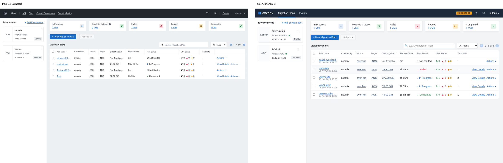

## Events

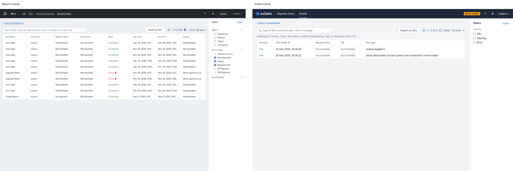

## User menu

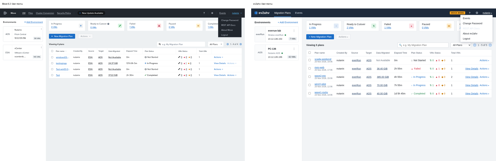

## Settings menu

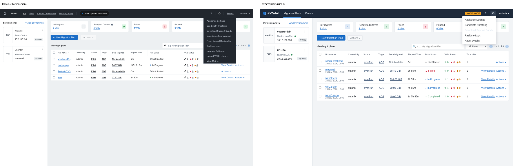

## About

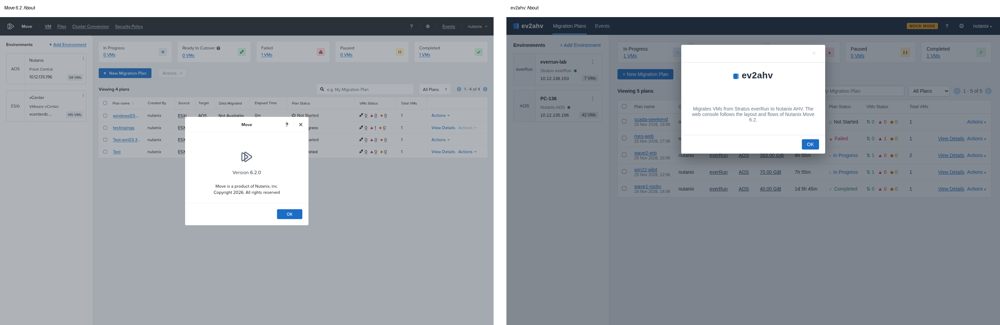

## Change password

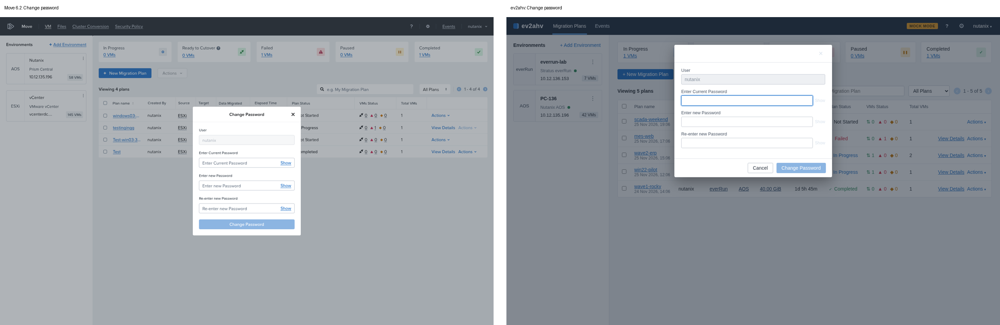

## Environment card menu

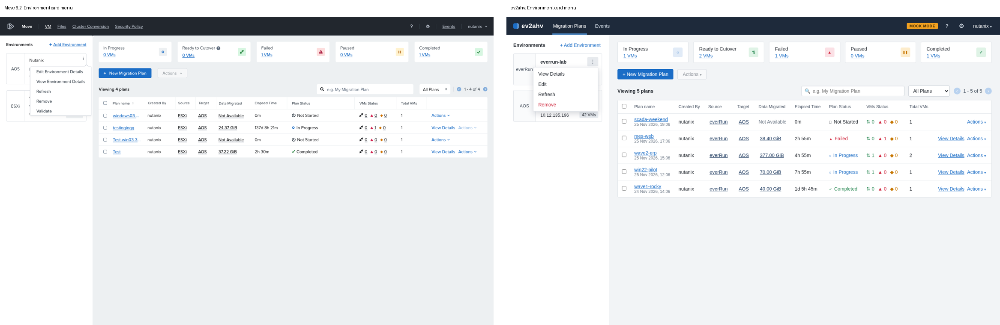

## Add environment

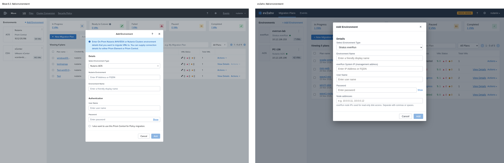

## Plan row actions

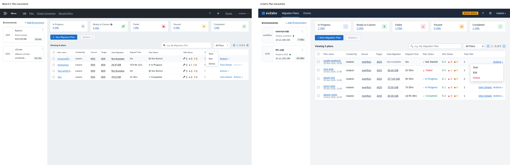

## Plan summary

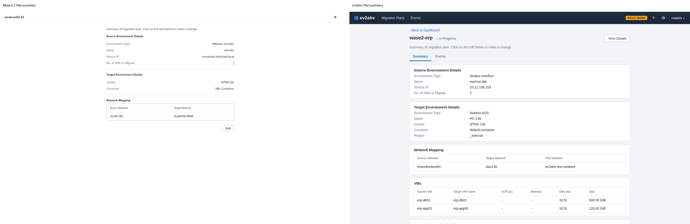

## Migration progress

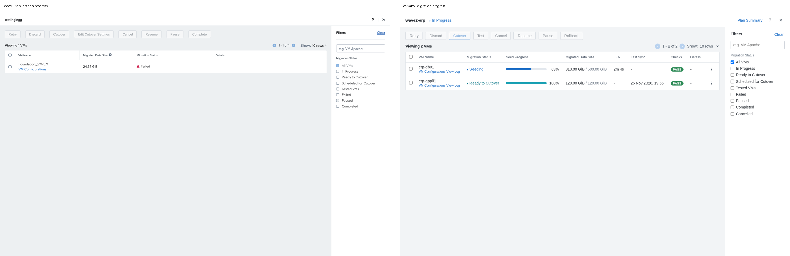

## Completed, target VM link

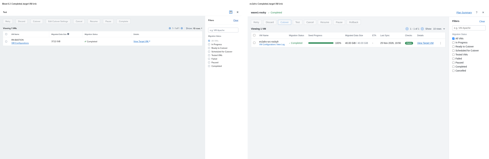

## Completed VMs list

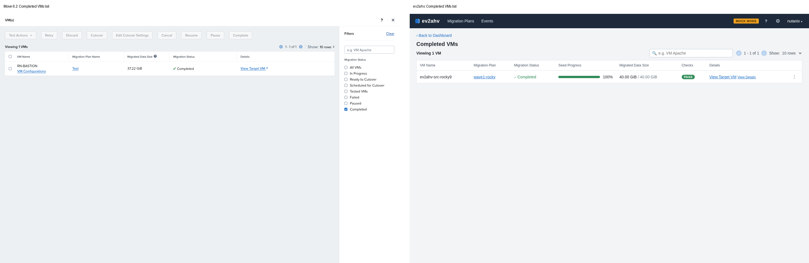

## Wizard: name

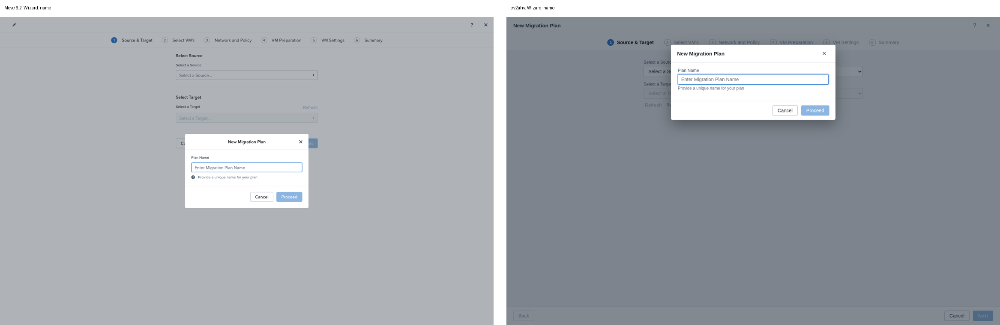

## Wizard 1: source and target

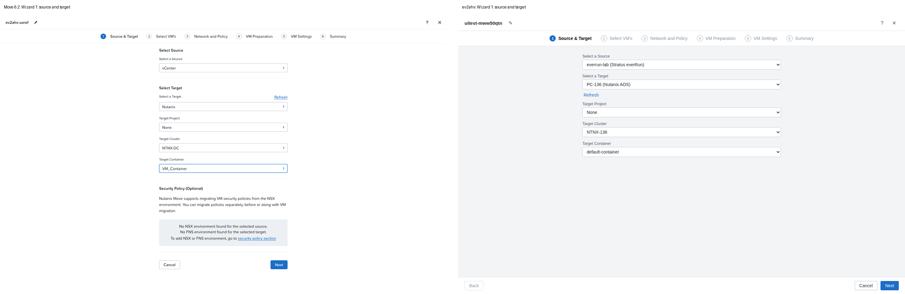

## Wizard 2: select VMs

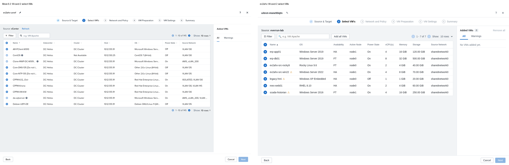

## Wizard 2: warnings

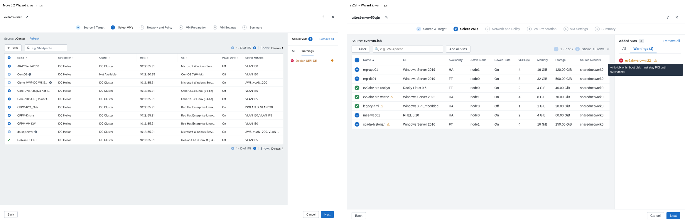

## Wizard 3: network

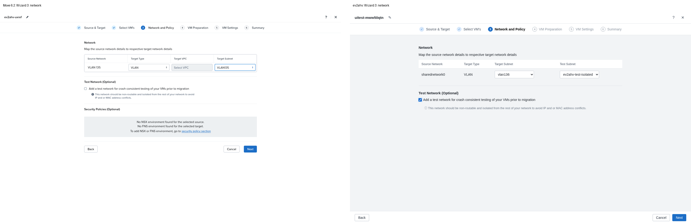

## Wizard 4: VM preparation (Move side: Move stopped at its step 3 capacity check, so its step 4 was never observed)

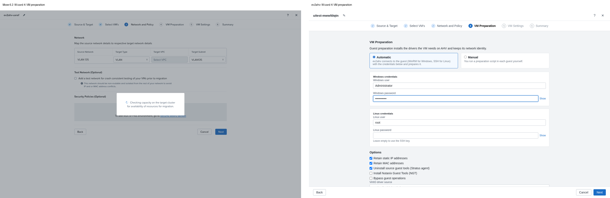

## Leave wizard

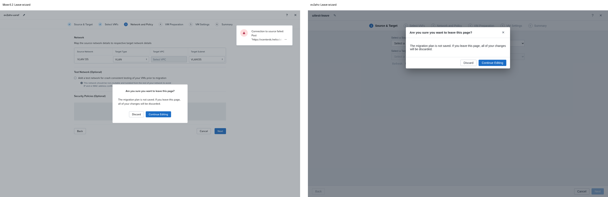

## Bandwidth throttling

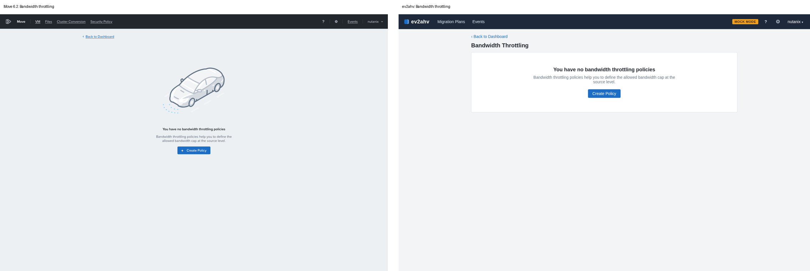

## Realtime logs

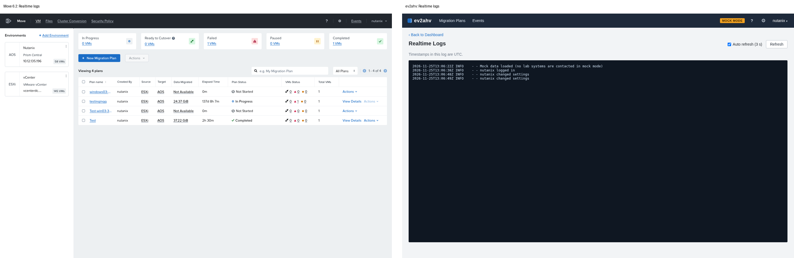

