# ev2ahv UI design: Material 3 Expressive

The first UI (Stage C) copied Nutanix Move's look almost pixel for pixel ([side-by-side.md](side-by-side.md), now historical). This redesign makes ev2ahv look like its own product. It keeps what users of Move rely on: the same routes, API calls, plan list, six-step wizard, per-VM actions and wording of the workflow. Only the look and the layout changed.

Status: built, type-checked (`npm run build`), screenshotted in mock mode, light and dark. Not verified against the live server, and not tested on a real Windows or phone browser.

Sources: the M3 Expressive blog post (https://m3.material.io/blog/building-with-m3-expressive) returned only its title to the fetch tool, so the design follows the published M3 Expressive concepts as known (shape scale with morphing, spring motion, emphasized type, tonal containers, extended FAB, split button, expressive loading indicator), not a line-by-line reading of that page.

## Rationale

- **Own identity.** Teal seed (#0B7F86) instead of Move's blue, a small "cookie" logo mark (two overlapped rounded squares, one rotated 45 degrees, with an arrow for "migrate") plus the wordmark "ev2ahv".
- **Different structure than Move.** Move has a dark top bar and a left environments panel. ev2ahv has a navigation rail/drawer on the left, an extended FAB for "New migration plan", status tiles as big tonal number cards, environments as cards in a strip, and plans as rounded tonal rows.
- **Expressive, but calm for an ops tool.** Big shapes and springy motion on press and selection; the data stays dense and readable. Status is always colour plus icon plus text, never colour alone.
- **Offline.** No CDN. The variable font is self-hosted. No icon font (inline SVG paths in `components/Icons.tsx`). No component library.

## Tokens

| Group | Where | What |
|---|---|---|
| Colour roles | `web/src/tokens.css` (generated) | M3 tonal-spot scheme from seed `#0B7F86`: primary, secondary, tertiary, error, surface and the five surface-container steps, outline, inverse. Two custom roles, `success` and `warning`, are generated with the same library (harmonized with the seed) so they have container and on-container pairs in both themes. |
| Theme | same file | Light by default, dark through `prefers-color-scheme: dark`. No toggle; it follows the OS. |
| Shape | `styles.css` `:root` | `--sh-xs 4, sm 8, md 12, lg 16, lg-inc 20, xl 28, xl-inc 32, full 999` (px). Cards 28, rows 20, buttons and chips full. |
| Typography | `styles.css` | Roboto Flex variable font (`web/public/fonts/RobotoFlex-latin-wght.woff2`, 34 kB, OFL licence file next to it). Emphasized weights: page titles 800 at 36 px, section titles 700, tile numbers 800 at 44 px, buttons 600. Latin subset only. |
| Motion | `styles.css` `:root` | `--spring` (CSS `linear()` spring with a small overshoot, with a `cubic-bezier(.34,1.56,.64,1)` fallback) for spatial changes such as shape morphs, dialogs and the stepper; `--effect` (standard decelerate) for colour and opacity. Durations 180, 320 and 520 ms. `prefers-reduced-motion` turns all animation and transitions off, including the loading indicator. |
| Elevation | `styles.css` | Only for FAB, menus, popovers, dialogs and toasts. Everything else is tonal (surface-container steps). |

To regenerate colours: in a scratch directory `npm i @material/material-color-utilities@0.3.0`, run `web/tools/gen-m3-tokens.cjs` (prints JSON with `light` and `dark` property lists) and put the values into `tokens.css`. The library is not a project dependency, so it does not touch `web/dist`.

## Components and where they are

| Pattern | Used for |
|---|---|
| Navigation rail / drawer | `components/NavRail.tsx`. 264 px drawer with labels above 960 px, 84 px icon rail below. Plans, Events, then an Appliance group (Health, Bandwidth, Realtime logs, Settings). Footer: support bundle, REST docs, About, Change password, user and log out. Selected item morphs from pill to rounded square. |
| Extended FAB | "New migration plan" (top of the rail, id `new-plan`). Presses to a larger radius. |
| Tonal cards | Source/target details, preparation, environments, credentials, summary. |
| Chips | Plan, VM and check status; counters; filter chips for VM status and event severity (square when off, pill with check when on). |
| Split button | Plan list rows (primary action plus the rest of the actions) and VM rows on the progress page. |
| Connected button group | The bulk action bar on the progress page (Retry, Discard, Cutover, Test, ...). |
| Stepper with progress | Wizard: six step pills plus a progress bar and "Step n of 6". Step content slides in with the spring. |
| Selection cards | Wizard prep mode (Automatic, Manual). Selected card changes shape. |
| Expressive loading indicator | `.spinner`: a solid shape that morphs between circle, squircle and blob while turning. Static square under reduced motion. |
| Progress bar | 14 px pill, springy fill. |

## Accessibility

- Focus: every control shows a 3 px primary-colour ring (`:focus-visible`); inputs get a ring plus a larger radius. Nothing relies on hover.
- Keyboard: all actions are real `button`/`a`/`input` elements. Menus close on Escape (split button) or outside click. Tab order follows the DOM, which was kept in step with the old UI.
- Checkboxes and radios are custom drawn but remain native inputs (`appearance: none`).
- Status chips carry an icon and the text, not just a colour.
- Reduced motion is honoured (see Motion).

### Contrast check

`node web/tools/contrast.mjs` checks the colour pairs the UI uses (every on-colour against its container, and text roles against all five surface steps) in light and dark, against WCAG AA 4.5:1.

Result: all 82 text pairs (41 per theme) pass. Non-text: outline on surface 4.37:1 (light) and 5.44:1 (dark), needs 3:1; focus ring (primary) on surface 6.31:1 and 10.08:1. Disabled controls are intentionally low contrast (exempt in WCAG). Not checked: contrast of the translucent hover and pressed layers, and screen reader behaviour (not tested with a reader).

## Before and after

Before (Move look, from git history `docs/ui-shots`) in `docs/ui-shots/before/`, after in `docs/ui-shots/light/` and `docs/ui-shots/dark/`.

### Dashboard

| Before | After (light) | After (dark) |
|---|---|---|
| 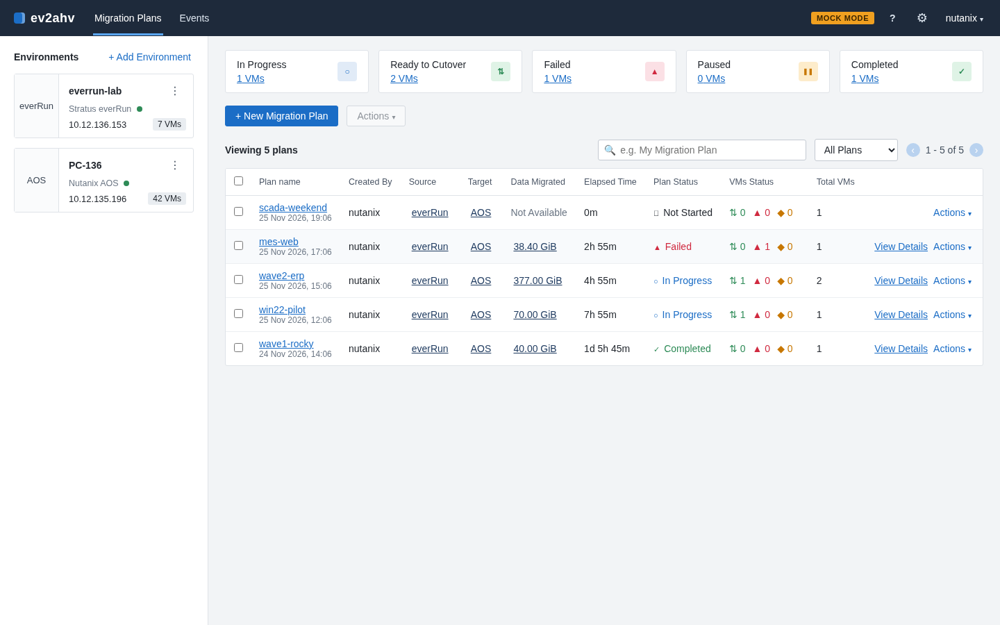 | 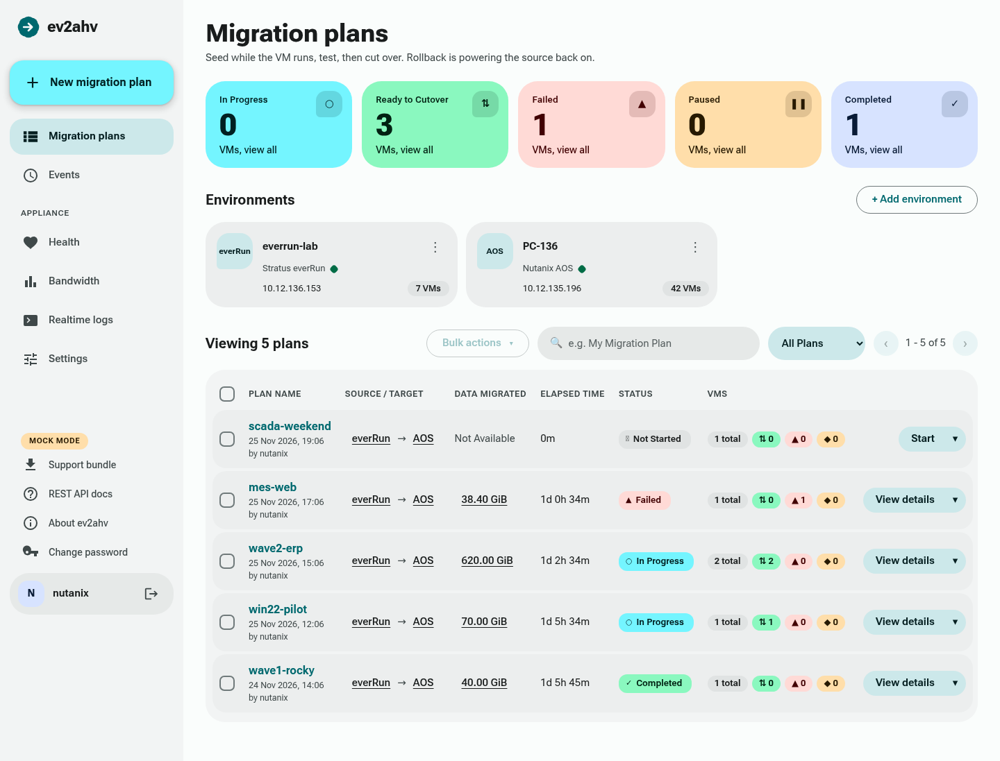 | 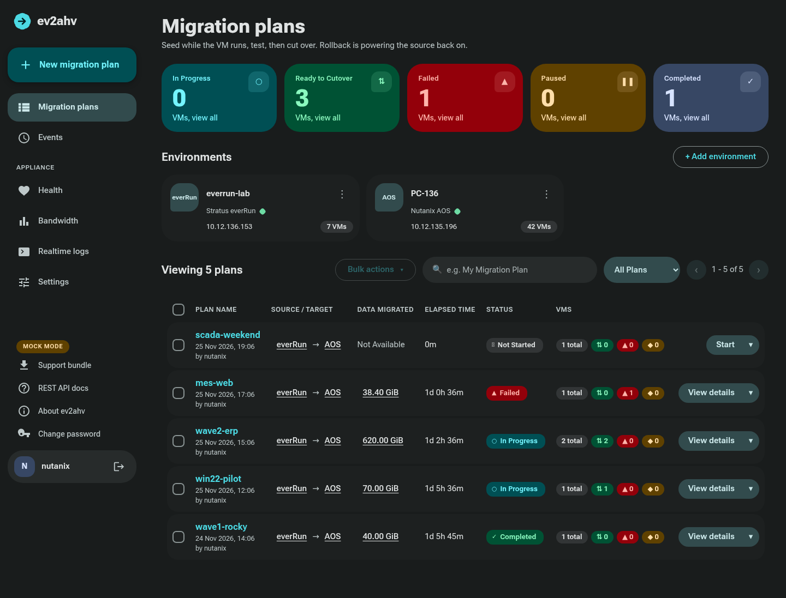 |

Top bar becomes the rail with an extended FAB. Five plain tiles become colour-coded number cards. The left environments panel becomes a card strip. Created-by merged into the plan name cell and source/target into one cell, so the action column fits next to the rail. "Actions" menus became split buttons.

### Migration progress

| Before | After (light) | After (dark) |
|---|---|---|
| 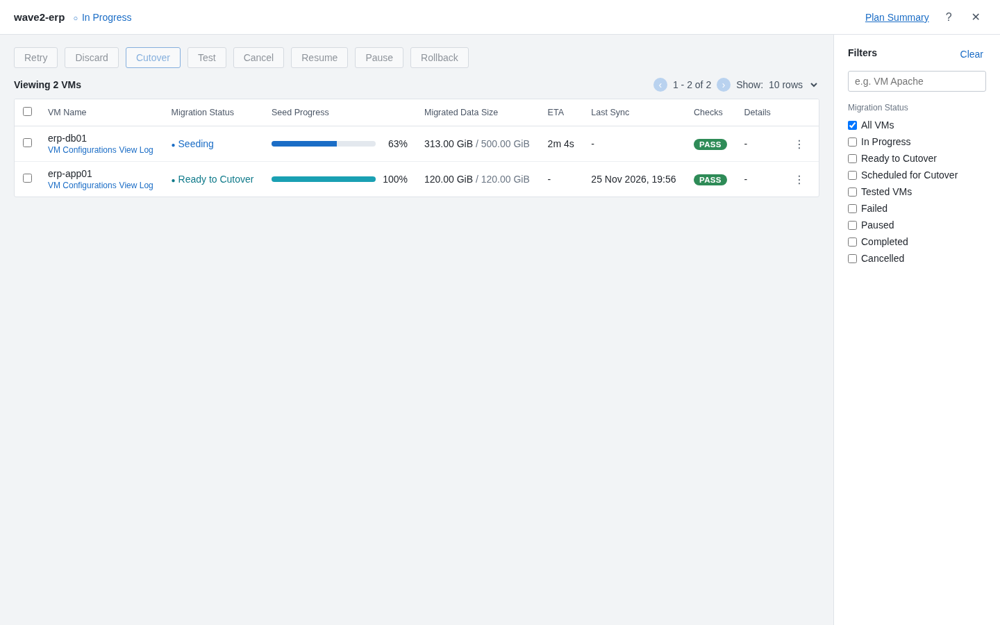 | 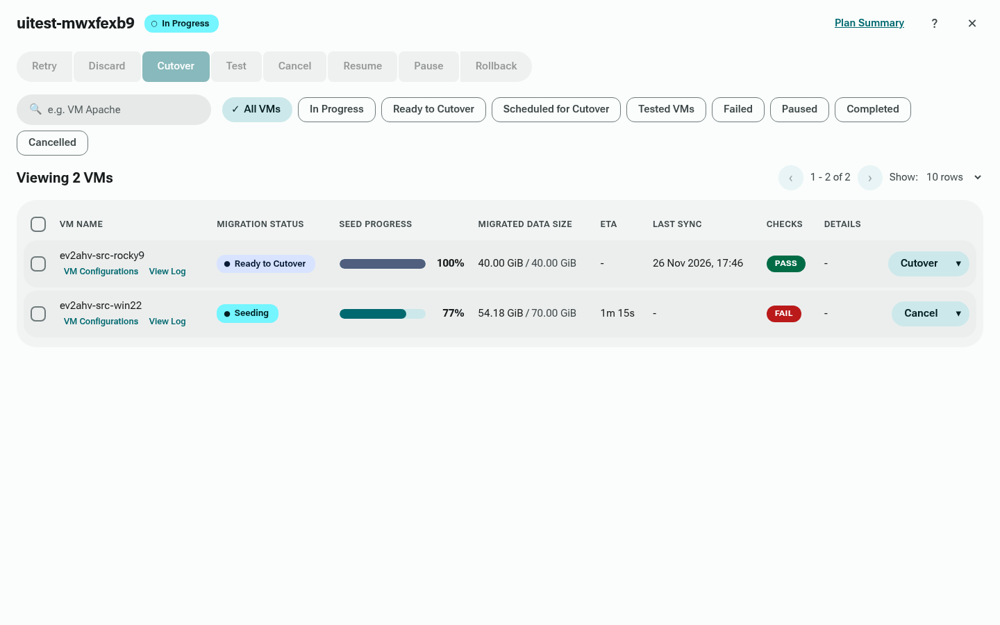 | 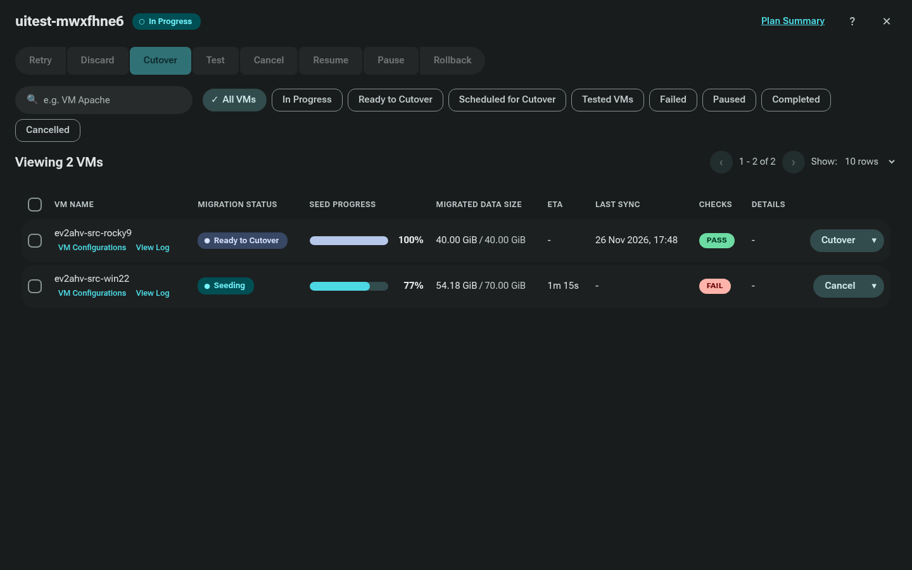 |

The right-hand filter panel became a chip bar above the table. Actions form a connected button group; per-VM actions are a split button; progress is a thick pill bar.

### Wizard, select VMs

| Before | After (light) | After (dark) |
|---|---|---|
| 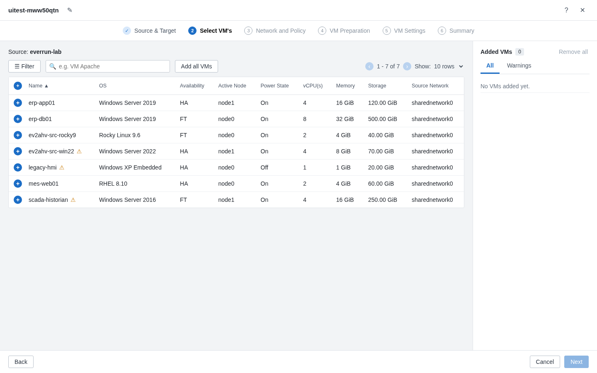 | 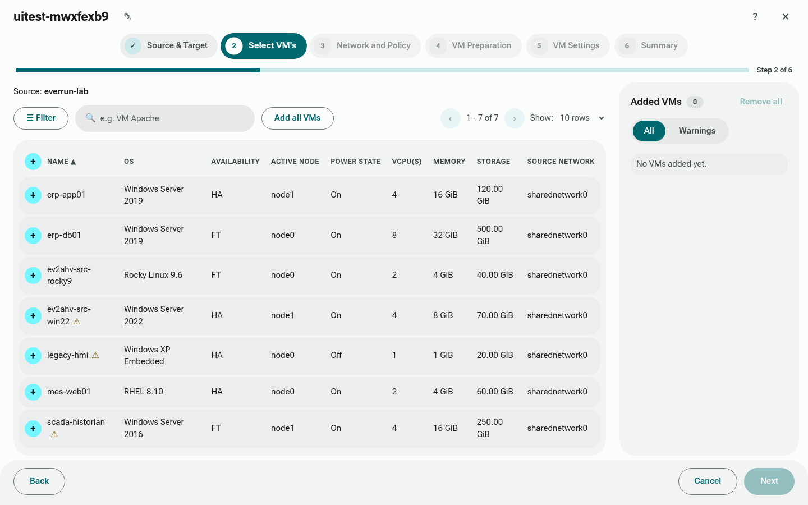 | 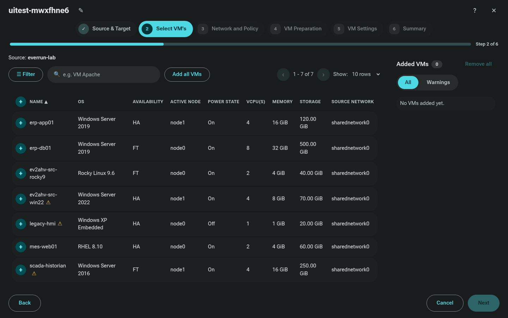 |

Numbered stepper pills plus progress bar, round add buttons that morph to a square when selected, tonal Added VMs panel.

### Wizard, preparation (with the prep-script fix)

| Before | After (light) | After (dark) |
|---|---|---|
| 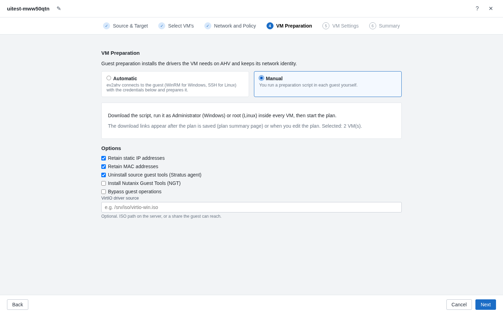 | 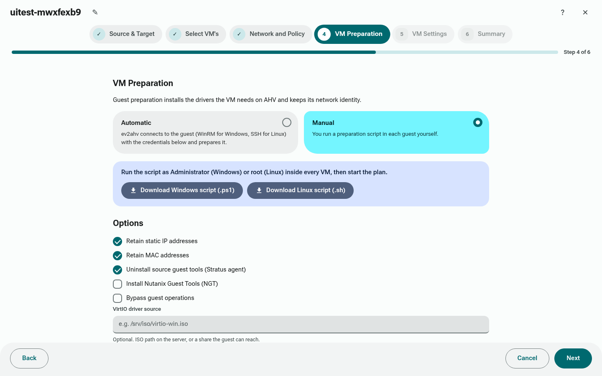 | 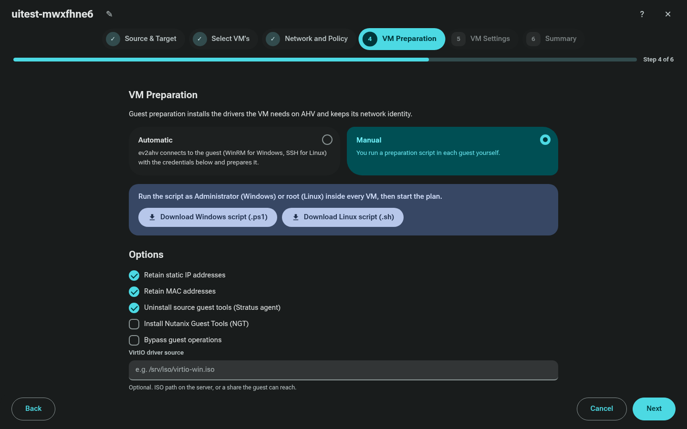 |

## Prep-script findability fix

Before: the download links showed only when preparation was Manual and the VM OS was known. Live discovery from everRun often leaves the OS unknown, so no link showed.

Now (`PrepScripts` in `components/VmParts.tsx`, used on Plan details and wizard step 4):

- The download is always offered.
- OS unknown (or mixed with unknown): both the Windows `.ps1` and the Linux `.sh` are shown, with a note that the OS is not known yet.
- Known OS: only the matching script(s).
- Automatic mode: the same buttons are labelled "Download for review: ..." with a line explaining that automatic mode runs the preparation itself.
- Wizard before the plan is saved: the old text "links appear after save" is gone. New server route `GET /api/v2/prep-script?os_type=windows|linux` serves the same files without a plan id (this is the only server change). The plan route `/api/v2/plans/{pid}/prep-script` is unchanged.

Checked in mock mode with curl, authenticated: both routes return 200 for `os_type=windows` (16599 bytes, PowerShell) and `os_type=linux` (10162 bytes, bash), and the plan route without `os_type` gives the Linux script (existing default). Any other `os_type` value also gives the Linux script (existing behaviour, not changed). Screenshots: `ui-116-step4-prep-manual` (wizard, manual), `ui-39b-plan-summary-prep-scripts` (plan details, automatic "for review"). The mock inventory reports the OS for every VM, so the "both scripts, OS unknown" case was not seen in a screenshot; it follows from the logic and is unconfirmed in a live run.

## How it differs from Move

| | Move 6.2 | ev2ahv now |
|---|---|---|
| Navigation | Dark top bar with Migration Plans, Events, gear and user menus | Left rail/drawer, extended FAB, appliance group |
| Colour | Blue and navy, flat white cards | Teal seed M3 roles, tonal surfaces, automatic dark theme |
| Shape | 3 px corners | 12 to 32 px corners, full pills, shape morph on press and selection |
| Type | System sans, 14 px | Roboto Flex variable, emphasized weights, 36 px titles |
| Lists | Bordered table | Rounded tonal rows, status chips, split buttons |
| Filters | Side panel with checkboxes | Filter chips above the table |
| Wizard | Plain tab strip | Step pills with progress bar, selection cards |
| Loading | Small spinner | Morphing shape indicator |
| Motion | None | Spring transitions, reduced-motion aware |

What stays: routes, API calls, the six wizard steps and their order, plan statuses and VM statuses, action names (Start, Edit, Delete, Test, Cutover, Rollback ...), and the Move-like per-VM log, configuration and prep-check dialogs.

## Size

`npm run build`: JS 274.11 kB (83.09 kB gzip), CSS 40.68 kB (8.47 kB gzip), index.html 0.5 kB gzip. Roboto Flex latin variable font 34 kB woff2 (loaded from `/fonts/`, not part of the JS bundle). Before this change the JS was about 81 kB gzip; the rail, split button, chips and prep-script component add about 2 kB. No new npm dependency.

## Screenshots

Produced by `node web/tools/shots.mjs light|dark` against the mock server (https://localhost:8443). 54 pages and steps per theme in `docs/ui-shots/light/` and `docs/ui-shots/dark/`. The script creates a `uitest-*` plan, drives it through Test and Cutover, and deletes every `uitest-*` plan again. Old screenshots of the Move look were removed from the tree (still in git history); four of them are kept in `docs/ui-shots/before/` for this document. The earlier force-password and health-certificate dialog shots were not recaptured.
